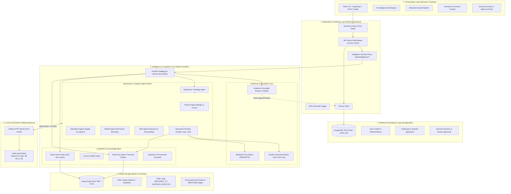

# CORTEX — Comprehensive System Audit & Target Implementation Roadmap
**Autonomous Multi-Agent Enterprise Decision Intelligence Platform**

---

| Document Metadata | Value |
| :--- | :--- |
| **Document Version** | 1.0.0 (Production Blueprint) |
| **Date** | 2026-11-17 |
| **Target System** | CORTEX (Collaborative Orchestration for Reasoning, Trends, Exploration and Execution) |
| **Authors** | Senior Software Architect & Lead AI Systems Engineer |
| **Repository Path** | `/home/obito/Downloads/nexus-enterprise-decision-intelligence-platform` |
| **Output Target** | `CORTEX_IMPLEMENTATION_ROADMAP.md` |
| **Target Hardware** | NVIDIA GeForce RTX 2050 (4GB VRAM), 15GB System RAM, x86_64 Linux |
| **Active Local LLM** | Ollama `cortex-qwen:latest` (Qwen2.5-Coder 3B, Q4_K_M, 1.9GB footprint) |

---

## 1. Executive Summary & Project Context

### 1.1 Project Vision vs. Current Reality
The core objective of **CORTEX** is to transform passive business intelligence dashboards into an **autonomous, evidence-grounded decision intelligence platform**. The target platform unifies:
1. A **React 19 + TypeScript** executive cockpit and interactive workspace.
2. A **PostgreSQL + Prisma** persistence layer for enterprise users, roles, audit trails, and decision state.
3. A **Neo4j Enterprise Knowledge Graph** (132,166 nodes, 379,361 relationships) with hybrid vector-graph retrieval (GraphRAG).
4. A **Five-Agent Cognitive Swarm** (Finance, Operations, Marketing, Risk, Strategy) capable of autonomous deliberation, structured tool invocation, and decision synthesis.
5. A **Predictive Analytics & Monte Carlo Engine** delivering statistically sound forecasts and risk-bounded simulation.
6. A **Human-in-the-Loop Governance Framework** producing verifiable, cryptographically chained Decision Dossiers requiring explicit human sign-off.

### 1.2 The Hardware Reality & Model Execution Profile
A foundational constraint of this engineering project is the local execution environment:
* **GPU**: NVIDIA GeForce RTX 2050 Mobile/Desktop (4,096 MiB total VRAM).
* **System RAM**: 15.0 GiB physical memory.
* **OS & Display**: Linux x86_64 running Wayland/KWin (which consumes ~500–800 MiB VRAM for desktop composition).
* **Available GPU VRAM for AI**: **~2,800 to 3,200 MiB**.

#### Benchmark & Compatibility Analysis:
* **`cortex-qwen:latest` (Qwen2.5-Coder 3B, Q4_K_M)**:
  * Disk Size: 1.9 GB.
  * Active GPU Memory: ~2,154 MiB VRAM.
  * Inference Speed: **42.1 tokens/second** (observed locally: 28 tokens generated in 664ms, prompt eval 38 tokens in 57ms).
  * Verdict: **Fully Operational & Primary Recommended Engine**. Fits comfortably inside RTX 2050 VRAM with zero CPU offload penalties.
* **`gemma4:latest` (Gemma 8B Q4_K_M)** / `cortex-gemma-cpu:latest`:
  * Disk Size: 9.6 GB.
  * VRAM Requirement: > 5,500 MiB (exceeds 4GB physical ceiling).
  * Behavior: Forces system to spill weights into CPU RAM via llamacpp/ggml, dropping throughput from >40 tps down to 1.5–3.5 tps and freezing the user desktop during active generation.
  * Verdict: **Incompatible for real-time multi-agent loops on current GPU**. Retained strictly for batch asynchronous CPU tasks or future hardware upgrades.

---

## 2. Comprehensive Audit of Actual Implementation (Truth Matrix)

The codebase was audited directly against the physical files, database tables, Neo4j graph instances, and live ports. Features are strictly classified into four operational states:
1. `[VERIFIED IMPLEMENTED]`: Code exists, automated tests pass, and functionality operates end-to-end.
2. `[PARTIALLY IMPLEMENTED / DISCONNECTED]`: Backend or component exists, but endpoints are disconnected from the UI or pipeline.
3. `[MOCK / HEURISTIC ONLY]`: UI renders visual components, but data and logic are hardcoded mock JSON, client-side formulas, or `setTimeout` stubs.
4. `[NOT IMPLEMENTED / PLANNED ONLY]`: Documented in slides or presentation outlines, but zero production code exists.

```
========================================================================================================================
MODULE / CAPABILITY                 STATUS                                 VERIFIED EVIDENCE & REALITY
========================================================================================================================
1. FRONTEND WORKSPACE
- Executive Overview                [VERIFIED IMPLEMENTED]                 React 19 + SVG charts, working filters (FY24/25,
                                                                           depts), verified in Phase B test suites.
- Scenario Simulator UI             [MOCK / HEURISTIC ONLY]                Renders sliders and dynamic curves, but calculations
                                                                           use client-side algebraic formulas in simulationEngine.ts.
- Forecasts View                    [MOCK / HEURISTIC ONLY]                Renders confidence intervals, but points are derived
                                                                           via client-side slice heuristics in forecastSeries.ts.
- Knowledge Graph Canvas            [MOCK / HEURISTIC ONLY]                Renders 16 hardcoded demo nodes from mock-data.json;
                                                                           completely disconnected from Neo4j (132k nodes).
- AI Intelligence Workspace         [MOCK / HEURISTIC ONLY]                Chat UI works visually, but sendMessage() executes
                                                                           a 500ms window.setTimeout() returning hardcoded text!
- Data Explorer                     [VERIFIED IMPLEMENTED]                 Allows CSV uploads, table preview, and sales record
                                                                           creation backed by PostgreSQL.
- AuthGate & RBAC                   [VERIFIED IMPLEMENTED]                 JWT auth cookies, role checks (Admin, Analyst, Executive).

2. NODE.JS / EXPRESS BACKEND
- Authentication & Sessions         [VERIFIED IMPLEMENTED]                 PBKDF2/SHA-512 password hashing, JWT refresh rotation,
                                                                           httpOnly cookies, Prisma User/Role schema.
- Data Fabric Endpoints             [VERIFIED IMPLEMENTED]                 CRUD on DataSource, SalesRecord, DatasetRecord.
- Governance & Settings             [VERIFIED IMPLEMENTED]                 AuditLog table, SystemSettings table, agent prompt edits.
- Intelligence Reverse Proxy        [PARTIALLY IMPLEMENTED / DISCONNECTED] Express routes (/api/intelligence/*) proxy to FastAPI,
                                                                           but Frontend IntelligenceContext never calls them!

3. KNOWLEDGE GRAPH & GRAPHRAG
- DataCo Pipeline Ingestion         [VERIFIED IMPLEMENTED]                 65,752 orders, 132,110 nodes, 379,120 relationships,
                                                                           0 missing provenance attributes, verified in D1 audit.
- Synthetic Procurement Delay       [VERIFIED IMPLEMENTED]                 120 POs, 24 shortage inventory slots, 15 delayed POs,
                                                                           deterministic random seed 20261112.
- Multi-Format Document Ingestion   [VERIFIED IMPLEMENTED]                 pypdf extractor, chunker with SHA-256 provenance,
                                                                           support for PDF, TXT, MD, CSV, JSON.
- Embeddings & Vector Index         [VERIFIED IMPLEMENTED]                 cortex_chunk_embedding_idx (512-dim cosine vector index),
                                                                           cortex-local-semantic-512-v1 deterministic embedder.
- Hybrid Multi-Hop Retrieval        [VERIFIED IMPLEMENTED]                 Reciprocal Rank Fusion (vector + fulltext + graph),
                                                                           4-6 hop Cypher traversal, temporal guardrails.
- Grounded Answer Synthesis         [PARTIALLY IMPLEMENTED / DISCONNECTED] answerer.py synthesizes deterministic templated reports
                                                                           with [C1..Ck] and [G1..Gm] citations, but NO LLM is used.

4. LOCAL LLM & AI AGENTS
- Ollama Local Service              [VERIFIED IMPLEMENTED]                 Ollama daemon active on port 11434 with cortex-qwen
                                                                           (Qwen2.5-Coder 3B, 42 tok/s on RTX 2050).
- LLM Connection in Backend         [NOT IMPLEMENTED / PLANNED ONLY]       Zero lines of code connect FastAPI or Express to
                                                                           Ollama. No client, no prompt templates, no streaming.
- 5 Cognitive Domain Agents         [NOT IMPLEMENTED / PLANNED ONLY]       Agents exist only as metadata rows in PostgreSQL
                                                                           (name, role, systemPrompt). No ReAct loops, no tools.
- Multi-Agent Deliberation Swarm    [NOT IMPLEMENTED / PLANNED ONLY]       No LangGraph, no state machine, no inter-agent debate.

5. PREDICTIVE ANALYTICS & SIMULATION
- Statistical Time-Series Models    [NOT IMPLEMENTED / PLANNED ONLY]       No statsmodels, Prophet, ARIMA, or scikit-learn models.
- Monte Carlo Engine                [NOT IMPLEMENTED / PLANNED ONLY]       No stochastic distribution engine; client simulation
                                                                           is deterministic arithmetic.
- Decision Dossier Engine           [NOT IMPLEMENTED / PLANNED ONLY]       No structured dossier generator, no PDF/dossier export,
                                                                           no formal cryptographic sign-off workflow.
========================================================================================================================
```

---

## 3. Gap Analysis, Technical Risks & Architectural Debt

### 3.1 Critical Gap: The Disconnected "Front-to-Back" Void
* **The Problem**: Phase B, Phase C, Phase D1, and Phase D2 were implemented as rigorous independent silos. The Python FastAPI intelligence service has production-grade GraphRAG and Neo4j traversal, and Express has working proxy routes, but **the React frontend never invokes them**.
* **Impact**: An executive typing into the AI Workspace receives a mock string from `IntelligenceContext.tsx` (`setTimeout(..., 500)`), completely unaware that a 132,000-node graph with verified GraphRAG citations is waiting on port 8001.
* **Remedy**: Wire `IntelligenceContext` and `KnowledgeGraph` directly to `/api/intelligence/*` endpoints.

### 3.2 Critical Gap: The Missing LLM & Agent Execution Engine
* **The Problem**: While the presentation slides boast a "5-Tier Multi-Agent Swarm with ReAct debate", **no LLM reasoning code exists**. The agents are static records in PostgreSQL (`aiAgent` table) storing static prompt strings.
* **Impact**: There is no actual AI reasoning occurring on the machine—only deterministic Cypher queries and string concatenation.
* **Remedy**: Build a lightweight, hardware-optimized Python Agent Engine in `cortex_intelligence` using `cortex-qwen` via Ollama's native HTTP REST API.

### 3.3 Hardware & Execution Bottleneck: RTX 2050 4GB Ceiling
* **The Problem**: Attempting to run large models (like Gemma 8B or Llama-3-8B) or fanning out 5 parallel agent LLM calls simultaneously will cause instant Out-Of-Memory (OOM) crashes or violent GPU-to-CPU thrashing.
* **Impact**: If two agents generate tokens concurrently, VRAM usage jumps past 4GB, causing OS compositor stuttering and process termination.
* **Remedy**:
  1. Pin all agent reasoning strictly to `cortex-qwen:latest` (3.1B parameters, Q4_K_M).
  2. Implement a **Sequential Execution Protocol**: Agents deliberate turn-by-turn through a shared state blackboard rather than parallel thread spawning.
  3. Keep the Ollama context window bounded to **4,096 tokens** (`num_ctx: 4096`) to prevent KV-cache VRAM expansion.

### 3.4 Operational Port Collision Risk
* **The Problem**: Port `8000` is currently bound on the host by an unrelated Docker container (`asian_paints_forecasting-api-1`).
* **Current Config**: CORTEX FastAPI is configured to run on port `8001` (`INTELLIGENCE_PORT=8001`, `INTELLIGENCE_SERVICE_URL=http://127.0.0.1:8001`).
* **Risk**: Any hardcoded assumption of port `8000` in frontend scripts or tests will fail. All routing must strictly adhere to environment configuration.

---

## 4. Target System Architecture

The target architecture must balance high research rigor with the strict reality of local hardware execution.



---

## 5. Phased Implementation Roadmap

The roadmap is structured in strict logical dependency order: **Infrastructure -> Reasoning Engine -> Analytics -> Integration -> Governance -> Hardening**.

```
[Phase 1: Local LLM Engine] ───> [Phase 2: Multi-Agent Swarm] ───> [Phase 3: Forecasting & Simulation]
                                                                                │
                                                                                ▼
[Phase 6: Hardening & Defense] <── [Phase 5: Dossier & Approvals] <── [Phase 4: Full-Stack Integration]
```

---

### Phase 1: Local LLM Integration & Structured Tool Runtime
* **Primary Objective**: Establish rock-solid, zero-overhead connectivity between the Python intelligence service and the local Ollama `cortex-qwen` model, supporting structured JSON schema output and deterministic tool calling.
* **Target Hardware Budget**: Pin to `cortex-qwen`, temperature 0.1–0.3, max tokens 1,024, context 4,096. Memory footprint: 2.1 GB VRAM.
* **Technologies**: Python `httpx`, Pydantic v2, Ollama REST API (`http://localhost:11434/api/chat`).
* **Expected Modules & Files**:
  * `intelligence/src/cortex_intelligence/llm/client.py`: High-performance asynchronous client for Ollama with exponential backoff and timeout handling.
  * `intelligence/src/cortex_intelligence/llm/prompts.py`: System prompt templates, few-shot examples, and JSON-schema constraints.
  * `intelligence/src/cortex_intelligence/llm/structured.py`: Output parser validating LLM responses against Pydantic models.
  * `intelligence/tests/test_ollama_runtime.py`: Automated tests for model response latency, JSON compliance, and error recovery.
* **Tasks**:
  1. Implement `OllamaClient` in Python utilizing `httpx.AsyncClient` with keep-alive connection pooling.
  2. Implement prompt formatting for Qwen2.5 ChatML format (`<|im_start|>system...<|im_end|>`).
  3. Build JSON-mode enforcement using Ollama's `format: "json"` parameter and Pydantic validation.
  4. Write automated test verifying `cortex-qwen` inference speed (>30 tok/s) and schema adherence.
* **Completion Gate**: `pytest tests/test_ollama_runtime.py` passes 100% with average response latency < 1.5 seconds.

---

### Phase 2: Autonomous Multi-Agent Decision Swarm
* **Primary Objective**: Replace mock text and static prompts with an autonomous multi-agent cognitive architecture where 5 specialized agents deliberate over enterprise decisions.
* **Agent Domain Specialization**:
  1. **Finance Agent**: Analyzes margin compression, COGS, working capital, and unit economics.
  2. **Operations Agent**: Analyzes supply bottlenecks, lead-time variance, warehouse inventory safety stock, and PO delivery delays.
  3. **Market Agent**: Evaluates price elasticity, regional sales velocity, customer segment impact, and competitor pressure.
  4. **Risk Agent**: Computes disruption probability, single-source supplier vulnerabilities, and financial loss limits.
  5. **Strategy Agent (Supervisor)**: Orchestrates the debate, synthesizes specialist findings into unified recommendations, and challenges assumptions.
* **Execution Strategy**: Sequential State Graph (Turn-Based Deliberation). To protect RTX 2050 VRAM, agents run **one at a time** through a shared `DeliberationState` object.
* **Technologies**: Python FastAPI, Pydantic, NetworkX / Custom State Graph, Neo4j Client.
* **Expected Modules & Files**:
  * `intelligence/src/cortex_intelligence/agents/base.py`: Base agent interface with role definition, memory, and tool invocation.
  * `intelligence/src/cortex_intelligence/agents/specialists.py`: Finance, Operations, Market, Risk specialist definitions.
  * `intelligence/src/cortex_intelligence/agents/supervisor.py`: Strategy Agent orchestrating debate rounds and consensus convergence.
  * `intelligence/src/cortex_intelligence/agents/tools.py`: Safe tool execution bus (Cypher execution tool, GraphRAG retrieval tool, SQL query tool).
  * `intelligence/src/cortex_intelligence/agents/orchestrator.py`: Multi-turn state graph runner.
  * `intelligence/src/cortex_intelligence/api/routes/agents.py`: FastAPI endpoints for multi-agent dispatch and streaming thoughts.
  * `intelligence/tests/test_agent_swarm.py`: Multi-agent debate verification test suite.
* **Tasks**:
  1. Implement structured agent tools (`query_knowledge_graph`, `retrieve_evidence_chunks`, `calculate_supplier_impact`).
  2. Implement the `DeliberationState` model recording agent thoughts, challenges, citations, and consensus.
  3. Implement the Strategy Agent supervisor logic: decomposes query -> dispatches to relevant specialists -> aggregates findings -> requests critique from Risk -> outputs final synthesis.
  4. Enforce strict citation requirements: Every numerical claim in an agent's response must reference either a Graph entity ID or a Document Chunk ID.
* **Completion Gate**: Multi-agent test query (`"Analyze supply delay impact of SYN-SUP-001"`) triggers Finance, Ops, Risk, and Strategy agents sequentially, returning an evidence-grounded consensus report with zero hallucinated IDs.

---

### Phase 3: Real Predictive Analytics & Monte Carlo Simulation
* **Primary Objective**: Transition forecasting and what-if simulation from client-side mock heuristics to a server-side scientific computing pipeline.
* **Predictive Forecasting**:
  * Implement statistical time-series forecasting (Exponential Smoothing / Holt-Winters and Autoregressive Ridge Regression) trained on historical DataCo empirical series (2015–2018).
  * Generate 3-month, 6-month, and 12-month projections with dynamic 80% and 95% confidence intervals.
* **Probabilistic Monte Carlo Engine**:
  * Replace the deterministic algebraic formula with a vectorized **10,000-iteration Monte Carlo simulation** (NumPy/SciPy).
  * Model key uncertain variables as probability distributions:
    * Lead time delay: Triangular / Log-normal distribution.
    * Price elasticity: Normal distribution ($\mu = -0.4, \sigma = 0.08$).
    * Material cost shock: Beta distribution.
  * Output probability density curves, Expected Value, Value-at-Risk (VaR 95%), and Worst-Case Loss.
* **Technologies**: Python `numpy`, `scipy`, `pandas`, FastAPI.
* **Expected Modules & Files**:
  * `intelligence/src/cortex_intelligence/analytics/forecasting.py`: Time-series models and confidence interval generators.
  * `intelligence/src/cortex_intelligence/analytics/simulation.py`: Vectorized Monte Carlo engine for scenario what-if modeling.
  * `intelligence/src/cortex_intelligence/api/routes/analytics.py`: Endpoints `/api/v1/analytics/forecast` and `/api/v1/analytics/simulate`.
  * `server/src/routes/scenario.routes.ts`: Enhanced to proxy complex simulation runs to Python while persisting saved scenario runs in PostgreSQL.
  * `intelligence/tests/test_analytics_and_simulation.py`: Mathematical verification tests.
* **Tasks**:
  1. Build historical time-series extraction from DataCo orders aggregated by month and category.
  2. Implement statistical baseline forecaster with confidence interval bounds.
  3. Build vectorized Monte Carlo simulation function calculating 10,000 sample paths in < 150ms.
  4. Expose clean REST endpoints and integrate with Express backend.
* **Completion Gate**: Simulation endpoint runs 10,000 Monte Carlo runs and returns VaR, profit distributions, and forecast series in < 300ms with verified statistical properties.

---

### Phase 4: Full-Stack Integration & Interactive Cockpit
* **Primary Objective**: Eliminate all frontend mock data and stubs, connecting the React UI to live backend and intelligence services.
* **Key Integrations**:
  1. **AI Intelligence Workspace**: Wire `IntelligenceContext.sendMessage()` to `POST /api/intelligence/agents/deliberate` (or `/graphrag/query`). Display live agent thought streams, role avatars, and verified citations.
  2. **Knowledge Graph View**: Connect `KnowledgeGraph.tsx` to `/api/intelligence/graph/*`. Render actual Neo4j subgraphs (Suppliers, PurchaseOrders, Warehouses, Products) with force-directed SVG layout and search filtering.
  3. **Forecasts View**: Replace `forecastSeries.ts` heuristics with live data from `/api/intelligence/analytics/forecast`.
  4. **Scenario Simulator**: Connect slider controls to live Monte Carlo simulation endpoint `/api/intelligence/analytics/simulate`, rendering dynamic probability distribution curves and VaR.
* **Technologies**: React 19, TypeScript, Lucide Icons, Fetch API with automatic JWT refresh.
* **Expected Modules & Files**:
  * `src/services/cortexApi.ts`: Add `agentApi`, `graphApi`, and `analyticsApi` clients.
  * `src/context/IntelligenceContext.tsx`: Completely refactored to remove `setTimeout` and bind to live backend SSE / REST streams.
  * `src/context/SimulationContext.tsx`: Updated to trigger server-side Monte Carlo calculations.
  * `src/components/views/KnowledgeGraph.tsx`: Dynamic Neo4j entity search and graph neighborhood rendering.
  * `src/components/views/AIWorkspace.tsx`: Live multi-agent debate visualization with interactive citation popups.
* **Tasks**:
  1. Extend `cortexApi.ts` with typed methods for multi-agent reasoning, graph statistics, subgraphs, and Monte Carlo runs.
  2. Replace mock timer in `IntelligenceContext.tsx` with asynchronous API calls handling loading, streaming tokens, and error fallbacks.
  3. Update `KnowledgeGraph.tsx` to fetch top nodes and expand relationships dynamically upon node click.
  4. Verify full application lifecycle under `npm run dev` and `npm run preview`.
* **Completion Gate**: User submits query in AI Workspace -> Live Ollama agent swarm reasons -> Output renders real Neo4j citations -> Clicking citation highlights node in KnowledgeGraph.

---

### Phase 5: Evidence-Based Decision Dossiers & Human Approval Workflow
* **Primary Objective**: Implement the formal governance layer that packages multi-agent analysis, simulation curves, and graph evidence into cryptographically signed Decision Dossiers requiring explicit human authorization.
* **Dossier Specification**:
  * **Header**: Unique Dossier ID (`DOS-2026-XXXX`), Timestamp, Triggering Incident/Query, Authoring Agents.
  * **Executive Synthesis**: Clear strategic recommendation formulated by the Strategy Agent.
  * **Agent Findings Matrix**: Detailed findings from Finance, Operations, Marketing, and Risk.
  * **Grounded Evidence Index**: Explicit table of Document Chunks and Neo4j Graph Paths cited.
  * **Quantitative Risk Bounds**: Monte Carlo VaR, Worst-Case Loss, Expected ROI.
  * **Alternative Actions**: Matrix of trade-offs considered and rejected.
  * **Human Approval State**: Pending | Approved | Rejected | Conditional, with Approver User ID, Role, Comments, and Web Crypto SHA-256 digital signature.
* **Technologies**: Prisma ORM, Web Crypto API, PostgreSQL, React PDF/Print Styles.
* **Expected Modules & Files**:
  * `server/prisma/schema.prisma`: Add `DecisionDossier` and `DossierApproval` models.
  * `server/src/routes/dossier.routes.ts`: Endpoints for generating, listing, viewing, and signing dossiers.
  * `src/components/views/DecisionDossierView.tsx`: Dedicated executive dossier review and sign-off interface.
  * `src/components/ReportModal.tsx`: Updated to render and export formal PDF/Markdown decision dossiers.
  * `server/src/utils/cryptoSignature.ts`: Deterministic SHA-256 hash chaining of dossier contents.
* **Tasks**:
  1. Add `DecisionDossier` schema to Prisma and run database migration.
  2. Build backend dossier compiler in Express/FastAPI aggregating agent debate history, simulation charts, and citations.
  3. Implement two-man / human-in-the-loop authorization gates (Analyst drafts -> Executive approves -> AuditLog permanently records).
  4. Build printable, executive-ready Dossier UI with Web Crypto digital signature verification.
* **Completion Gate**: Full lifecycle: Incident query -> Agent swarm generates dossier -> Executive reviews in UI -> Approves with password/signature -> Audit log cryptographically sealed in Postgres.

---

### Phase 6: System Hardening, Benchmarking & Production Readiness
* **Primary Objective**: Ensure production stability, comprehensive automated test coverage, strict defense against prompt injection, and flawless execution for final academic defense.
* **Key Deliverables**:
  1. **Comprehensive Test Suite**: End-to-end integration tests spanning React -> Express -> FastAPI -> Ollama -> Neo4j -> Postgres.
  2. **Academic Benchmark Suite**: Measurable metrics assessing:
     * GraphRAG Faithfulness & Answer Relevance.
     * Hallucination Rate (verifying 0 fabricated entity IDs).
     * Agent Deliberation Latency and VRAM consumption profiling on RTX 2050.
  3. **Security & Guardrails**:
     * Prompt injection sanitization for user queries before sending to Ollama.
     * Rate limiting on AI endpoints to prevent VRAM starvation.
     * Input validation on all numerical parameters.
  4. **One-Click Orchestration & Runbook**: Clean system startup script (`scripts/start_cortex.sh`) launching Postgres, Neo4j, Ollama, FastAPI, Express, and Vite.
* **Technologies**: `pytest`, Vitest / Playwright, Docker, Bash.
* **Completion Gate**: 100% automated test pass rate across all tiers, 0 runtime console errors, and successful end-to-end demonstration within 4GB VRAM.

---

## 6. Team Responsibility & Work Breakdown (3 Team Members)

To ensure efficient parallel progress during the academic project schedule, responsibilities are divided cleanly along architectural boundaries with minimal merge conflict overlap:

```
+----------------------------------------------------------------------------------------------------+
|                                    CORTEX TEAM DIVISION OF LABOR                                   |
+-----------------------------------+----------------------------------+-----------------------------+
| MEMBER 1: AI & AGENT LEAD         | MEMBER 2: DATA & ANALYTICS LEAD  | MEMBER 3: FULL-STACK & GOV  |
+-----------------------------------+----------------------------------+-----------------------------+
| • Ollama Client & JSON runtime    | • Neo4j Cypher Traversal API     | • Express Gateway & Auth    |
| • 5 Agent Prompts & Personas      | • GraphRAG Retrieval Tuning      | • React Frontend Contexts   |
| • Sequential Deliberation State   | • Time-Series Forecast Models    | • AI Workspace & Graph UI   |
| • Agent Tool Invocation Bus       | • Monte Carlo Simulation Engine  | • Decision Dossier Workflow |
| • LLM Evaluation & Hallucination  | • Data Quality & Provenance      | • Audit Chaining & Crypto   |
|   Benchmarking                    | • Math Testing & Performance     | • End-to-End Build & Demo   |
+-----------------------------------+----------------------------------+-----------------------------+
```

### Detailed Member Work Packages:

#### Member 1: AI, Agent Swarm & LLM Lead
* **Phase 1**: Builds `llm/client.py` and establishes robust communication with Ollama `cortex-qwen`.
* **Phase 2**: Authors the 5 specialist agent prompts (Finance, Ops, Market, Risk, Strategy) and implements the turn-based `supervisor.py` state graph.
* **Phase 3**: Integrates agent tool-calling with Member 2's analytics engines.
* **Phase 4**: Collaborates with Member 3 on streaming thought protocols to the UI.
* **Phase 6**: Conducts academic agent benchmarking (faithfulness, latency, token throughput, citation precision).

#### Member 2: Knowledge Graph, Analytics & Simulation Lead
* **Phase 1**: Tunes Neo4j vector/fulltext indexes and implements Cypher query tools for agents.
* **Phase 2**: Builds the safe tool execution bus (`query_graph`, `retrieve_chunks`).
* **Phase 3**: Implements statistical forecasting (ARIMA/Holt-Winters) and the 10,000-run vectorized Monte Carlo simulation engine.
* **Phase 4**: Connects real graph subgraphs and analytics payloads to the API endpoints.
* **Phase 6**: Documents data provenance, performance metrics, and mathematical validation for the project thesis.

#### Member 3: Full-Stack Architecture, Governance & UI Lead
* **Phase 1 & 2**: Maintains Express backend proxy routes, Prisma schemas, and database migrations.
* **Phase 4**: Refactors React contexts (`IntelligenceContext`, `SimulationContext`, `KnowledgeGraph`), removing all mock timers and connecting live UI views to backend endpoints.
* **Phase 5**: Implements the Decision Dossier schema, approval state machine, Web Crypto SHA-256 signing, and print/export layouts.
* **Phase 6**: Manages Vite build pipelines, end-to-end integration tests, startup orchestration scripts, and final presentation demo staging.

---

## 7. Testing, Evaluation & Quality Assurance Plan

### 7.1 Tiered Testing Architecture
1. **Tier 1: Unit Tests (Python & TypeScript)**:
   * Python (`pytest`): Verify Ollama JSON parsing, prompt formatting, mathematical simulation distributions, chunking, and embeddings.
   * TypeScript (`tsc --noEmit`): Strict type checking across both frontend and backend.
2. **Tier 2: Integration Tests**:
   * Test FastAPI `/api/v1/agents/deliberate` with live Ollama `cortex-qwen` model.
   * Test Neo4j Cypher queries against running Docker container (`cortex-neo4j`).
   * Test Express proxy endpoints forwarding JWT headers and service keys to FastAPI.
3. **Tier 3: End-to-End Decision Flow Tests**:
   * Automated script executing: User Query -> Multi-Agent Swarm -> GraphRAG Retrieval -> Monte Carlo Run -> Dossier Generation -> Approval Signature -> Postgres Audit Record.

### 7.2 Academic AI Evaluation Metrics (RAG & Agent Benchmarking)
For the undergraduate project defense, qualitative impressions are insufficient. The system will report concrete quantitative benchmarks:
* **Context Precision & Recall**: Percentage of retrieved document chunks and graph paths directly relevant to the business query.
* **Faithfulness Metric**: Ratio of generated claims directly supported by citations in `[C1..Ck]` or `[G1..Gm]`. Target: **$\ge 95\%$**.
* **Hallucination Rate**: Count of non-existent entity IDs or fabricated financial metrics. Target: **$0.0\%$**.
* **Inference Throughput**: Tokens per second generated by `cortex-qwen` on the RTX 2050. Target: **$\ge 35 \text{ tok/s}$**.
* **Decision Latency**: Total wall-clock time for a full 4-agent sequential deliberation cycle. Target: **$\le 12 \text{ seconds}$**.

---

## 8. Hardware Optimization Playbook (RTX 2050 4GB VRAM)

To guarantee flawless stability on an RTX 2050 with 4GB VRAM, the following operational rules are mandatory:

1. **Strict Model Pinning**:
   * **Do NOT attempt to load 8B+ models into GPU memory**. Any switch to Gemma 8B must use CPU-only mode (`OLLAMA_NUM_GPU=0`) or be reserved for offline batch jobs.
   * Keep `cortex-qwen` as the primary operational model for all interactive workflows.
2. **Context Window Ceiling**:
   * Set `num_ctx: 4096` in all Ollama API calls. A 4K context keeps the KV cache footprint under 300 MiB VRAM.
3. **Sequential Execution Protocol**:
   * Never issue concurrent prompts to Ollama. The Multi-Agent Swarm must execute turn-by-turn.
4. **Fast Local Embeddings**:
   * Retain the existing `LocalSemanticEmbeddingProvider` (`cortex-local-semantic-512-v1`) in Python. It executes on CPU in < 5ms with zero VRAM consumption, reserving 100% of available GPU memory for LLM generation.
5. **Port Governance**:
   * Ensure CORTEX FastAPI runs on port `8001` (`INTELLIGENCE_PORT=8001`) to avoid conflict with port `8000`.

---

## 9. Master Project Timeline & Milestones

```
+========================================================================================================+
| WEEK / TIMELINE       | PHASE              | KEY DELIVERABLE                                           |
+========================================================================================================+
| Week 1 (Days 1–5)     | Phase 1            | Ollama Client, JSON Schema Parser, Prompt Engine          |
| Week 2 (Days 6–12)    | Phase 2            | 5 Cognitive Agents, Sequential Deliberation Graph         |
| Week 3 (Days 13–18)   | Phase 3            | Statistical Forecaster & Vectorized Monte Carlo Engine    |
| Week 4 (Days 19–25)   | Phase 4            | Full-Stack UI Integration (Live Workspace & Graph)        |
| Week 5 (Days 26–30)   | Phase 5            | Decision Dossier System, Cryptographic Approval Workflow  |
| Week 6 (Days 31–35)   | Phase 6            | Academic Benchmarking, Thesis Prep & Final Viva Defense   |
+========================================================================================================+
```

---

## 10. Conclusion & Architectural Sign-Off

The CORTEX platform has established an exceptionally strong data and knowledge foundation through Phases A, B, C, D1, and D2:
* A high-fidelity React frontend with clean architectural context separation.
* A secure, RBAC-protected Node.js/Express backend with Prisma and PostgreSQL.
* A fully validated 132,000-node Neo4j supply chain knowledge graph.
* A complete, multi-format hybrid GraphRAG retrieval pipeline.

The roadmap documented herein establishes the exact, realistic bridge connecting these foundations to true autonomous AI decision intelligence. By strictly adhering to hardware constraints (Qwen 3B on RTX 2050), prioritizing a sequential multi-agent protocol, and replacing mock stubs with verified server-side analytics, the CORTEX team will deliver an academically distinguished, production-grade enterprise decision intelligence platform.

