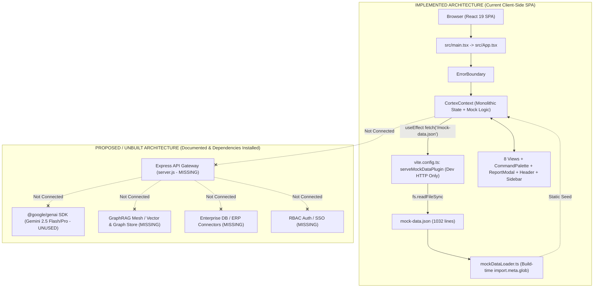
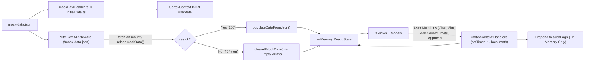
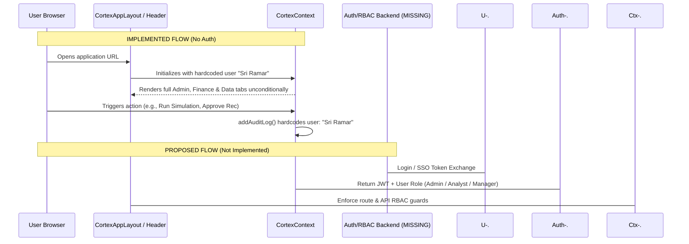
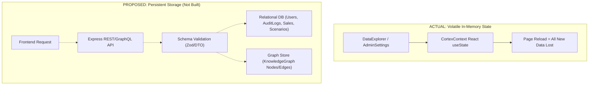

# CORTEX / NEXUS — Current Phase Built & Technical Project Audit

**Original Pre-Refactor Audit Date:** 2026-11-11 (historical baseline preserved below)  
**Latest Status Update:** **2026-11-12 — Phases A, B, C, and D1 Complete**  
**Project Directory:** `nexus-enterprise-decision-intelligence-platform` (`package.json`: `cortex-enterprise-decision-intelligence-platform`, branded internally as **CORTEX — Enterprise Decision Intelligence Platform**)

> [!IMPORTANT]
> **Post-Audit Delivery Status (Updated 2026-11-12):**  
> - **Phase A (Frontend Stabilization & Critical Bug Fixes):** **COMPLETE** — see [PHASE_A_COMPLETION_REPORT.md](file:///home/obito/Downloads/nexus-enterprise-decision-intelligence-platform/PHASE_A_COMPLETION_REPORT.md). Fixed trend/forecast schemas, `NaN` SVG/hover crashes, production asset bundling, Knowledge Graph drag & edge filtering, Scenario Simulator reset & negative EBITDA math, extracted shared chart helpers, standardized `CORTEX` naming, and enabled TypeScript `"strict": true`.  
> - **Phase B (Complete Existing Frontend Modules):** **COMPLETE** — see [PHASE_B_COMPLETION_REPORT.md](file:///home/obito/Downloads/nexus-enterprise-decision-intelligence-platform/PHASE_B_COMPLETION_REPORT.md). Refactored `CortexContext` into domain contexts, wired Executive Overview department/period filters, built dynamic CSV ingestion/profiling in Data Explorer, completed Scenario Simulator portfolio & Risk/Detailed tabs, wired Forecasts metric/horizon/unit scaling, and added Web Crypto SHA-256 chain/dossier hashing.  
> - **Phase C (Backend, Database, Authentication & API Integration):** **COMPLETE** — see [PHASE_C_COMPLETION_REPORT.md](file:///home/obito/Downloads/nexus-enterprise-decision-intelligence-platform/PHASE_C_COMPLETION_REPORT.md). Implemented standalone Node/Express/TypeScript backend (`server/`), PostgreSQL + Prisma normalized schema & migrations, idempotent seeding (`prisma/seed.ts`), bcrypt password hashing, HTTP-only JWT cookie auth + refresh rotation, RBAC (`Admin`, `Executive`, `Analyst`, `Viewer`) with `401`/`403` enforcement, Vite dev/preview `/api` proxy, and full frontend API hydration replacing business-data `localStorage`.  
> - **Phase D1 (Enterprise Data Acquisition, Ingestion & Knowledge Graph Foundation):** **COMPLETE** — see [PHASE_D1_COMPLETION_REPORT.md](file:///home/obito/Downloads/nexus-enterprise-decision-intelligence-platform/PHASE_D1_COMPLETION_REPORT.md).
> - **Phase D2 (GraphRAG Intelligence Engine):** **COMPLETE** — hybrid vector + BM25 + Neo4j multi-hop retrieval service.
> - **Phase 1 (Local LLM Integration):** **COMPLETE** — see [PHASE_1_IMPLEMENTATION_REPORT.md](file:///home/obito/Downloads/nexus-enterprise-decision-intelligence-platform/PHASE_1_IMPLEMENTATION_REPORT.md). Local Ollama `cortex-qwen:latest` on RTX 2050 (4GB VRAM) with concurrency lock and Pydantic validation.
> - **Phase 2 (Multi-Agent Orchestration):** **COMPLETE** — see [PHASE_2_IMPLEMENTATION_REPORT.md](file:///home/obito/Downloads/nexus-enterprise-decision-intelligence-platform/PHASE_2_IMPLEMENTATION_REPORT.md). Sequential 5-agent deliberation (Finance, Operations, Marketing, Risk, Strategy Supervisor) with monotonic state machine and GraphRAG evidence grounding.
> - **Phase 3 (Hybrid Data Engineering & Predictive Intelligence):** **COMPLETE** — see [PHASE_3_IMPLEMENTATION_REPORT.md](file:///home/obito/Downloads/nexus-enterprise-decision-intelligence-platform/PHASE_3_IMPLEMENTATION_REPORT.md) and [PHASE_3_DATA_ENGINEERING_DESIGN.md](file:///home/obito/Downloads/nexus-enterprise-decision-intelligence-platform/PHASE_3_DATA_ENGINEERING_DESIGN.md). Dual-stream DataCo & Olist hybrid pipeline (1.73M records), LightGBM delivery delay classifier (72.0% accuracy, 85.3% precision), Random Forest stockout classifier (100% accuracy), 7d/30d/90d HistGradientBoosting demand forecaster, and vectorized Monte Carlo simulation engine with VaR-95/99 and CVaR. All 36 automated tests passing.
> - **Phase 4 (Decision Reports & Human-in-the-Loop Approval):** **NEXT** (Ready to begin).

---

*(Sections 1–19 below preserve the original 2026-11-11 pre-Phase-A baseline audit for traceability; see Section 20 for the updated current-state table.)*

## 1. Executive Summary

The repository currently implements a **client-side interactive UI prototype (Phase-I Frontend Prototype)** of an enterprise decision intelligence platform named **CORTEX** (housed in the `nexus-enterprise-decision-intelligence-platform` folder). Built with **React 19**, **TypeScript**, **Vite 8**, and **Tailwind CSS v4**, it delivers an 8-view dark-themed analytical dashboard (`ExecutiveOverview`, `DataExplorer`, `AIWorkspace`, `KnowledgeGraph`, `ForecastsView`, `ScenarioSimulator`, `RecommendationsView`, and `AdminSettings`), a `⌘K` `CommandPalette`, an `ErrorBoundary`, and a `ReportModal` containing both a 16-slide Undergraduate Project Review presentation viewer and an Executive Dossier printout.

**Critical Reality Check vs. Documentation & Dependencies:**
While `package.json`, `.env.example`, `metadata.json`, `README.md`, and `UG_PROJECT_FIRST_REVIEW_PRESENTATION.md` describe a full-stack AI platform backed by the Google Gemini API (`@google/genai`), `express`, `dotenv`, GraphRAG multi-hop reasoning, and 4-agent/5-agent orchestration:
1. **There is NO backend server.** `express` and `dotenv` are installed in `package.json` (`"clean": "rm -rf dist server.js"`), but no `server.js`, `server.ts`, API route handlers, or middleware exist in the repository.
2. **There is NO live AI integration.** `@google/genai` is declared in `package.json` (`^2.4.0`), but it is **never imported or invoked anywhere in `src/`**. The multi-agent chat in `src/context/CortexContext.tsx` uses a `1200ms` `setTimeout` and basic keyword checks (`profit`/`margin`, `supply`/`chain`/`cost`, `expand`/`market`/`sales`) returning canned responses.
3. **There is NO database or persistence layer.** All application state lives exclusively in React `useState` inside `src/context/CortexContext.tsx`, seeded at startup from `mock-data.json`. Refreshing the browser discards all user mutations (saved scenarios, new chats, invited users, recommendation approvals, agent settings, and audit logs).
4. **There are NO automated tests** and **NO Git repository** (the workspace is an unversioned file archive).
5. **Production build breakage risk & live runtime bugs exist:** `ExecutiveOverview.tsx` has a schema mismatch with `mock-data.json` (`d.value` vs `d.rev`) that causes `NaN` SVG coordinates and a crash (`TypeError`) on chart point hover; `vite.config.ts` serves `/mock-data.json` only in dev mode, meaning a static production build (`vite build`) will fail to fetch `/mock-data.json` and wipe all UI data on mount.

In short, the project is **halfway through a Phase-I → Phase-II academic/enterprise build**: the visual shell, navigation, layout ergonomics, and deterministic client-side simulation math are largely built, whereas the entire backend, database, authentication, live Gemini multi-agent orchestration, GraphRAG pipeline, and test suite remain **unimplemented**.

---

## 2. Project Overview

### 2.1 Original Project Objective (from Documentation & Code Evidence)
Based on `UG_PROJECT_FIRST_REVIEW_PRESENTATION.md` (lines 1–351) and `mock-data.json` (`slides` array, lines 782–1031), this project originates as an Undergraduate Final Year Major Project (Phase-I Review) titled:
> *"CORTEX: Autonomous Multi-Agent Enterprise Decision Intelligence Platform with GraphRAG Knowledge Graphs and Predictive Scenario Simulation"*

The documented 5-tier architecture aims to combine:
1. **Tier 1 — Data Ingestion:** Structured ERP/CRM/WMS telemetry + unstructured PDF/text filings.
2. **Tier 2 — GraphRAG Knowledge Mesh:** Entity-relationship extraction, in-memory directed graph traversal (`<50ms`), and community clustering.
3. **Tier 3 — Multi-Agent Dialectic Swarm:** Specialized domain agents (Finance, Operations, Market, Risk, Strategy) debating evidence via ReAct-style pipelines powered by Google Gemini 2.5 Flash/Pro.
4. **Tier 4 — Predictive & Simulation Core:** Multivariate forecasting with confidence bounds and real-time parametric sensitivity analysis (What-If EBITDA/margin calculations).
5. **Tier 5 — Executive Workspace:** Interactive React 19 dashboard with dual-currency (`₹ Cr` / `$ M`) scaling, ergonomic zoom scales, interactive SVG entity graph, and board-ready dossiers.

### 2.2 Naming Split (`NEXUS` vs `CORTEX` vs `react-example`)
An incomplete mid-development rebrand is visible across the repository:
- **Repository folder:** `nexus-enterprise-decision-intelligence-platform`
- **`package.json`:** `"name": "react-example"`, `"version": "0.0.0"`
- **UI & Docs branding:** `"CORTEX"` (`index.html`, `metadata.json`, `src/components/Sidebar.tsx`, `src/components/Header.tsx`, `UG_PROJECT_FIRST_REVIEW_PRESENTATION.md`)
- **Dual barrel exports:**
  - `src/types/nexus.ts` holds all domain types; `src/types/cortex.ts` simply re-exports `export * from './nexus';`.
  - `src/context/CortexContext.tsx` holds all state logic; `src/context/NexusContext.tsx` simply re-exports `export * from './CortexContext';`, and `CortexContext.tsx` exports `NexusProvider` and `useNexus` aliases.
  - `src/components/views/KnowledgeGraph.tsx` line 248 checks `node.id === 'cortex-corp' || node.id === 'nexus-corp'`.

---

## 3. Technology Stack

### 3.1 Verified Installed Stack (`package.json`)

| Layer | Technology | Declared Version | Usage Status in `src/` |
|---|---|---|---|
| **UI Library** | `react`, `react-dom` | `^19.0.1` | Actively used across all views and components |
| **Language** | `typescript` | `^7.0.2` | Actively used (`tsc --noEmit` passes; `strict` disabled) |
| **Build Tool** | `vite`, `@vitejs/plugin-react` | `^8.3.0`, `^6.1.1` | Actively used with custom dev middleware plugin |
| **Styling** | `tailwindcss`, `@tailwindcss/vite`, `autoprefixer` | `^4.3.3`, `^4.3.3`, `^10.4.21` | Actively used via `@import "tailwindcss";` in `src/index.css` |
| **Icons** | `lucide-react` | `^0.546.0` | Actively used across all UI modules |
| **AI SDK** | `@google/genai` | `^2.4.0` | **Declared in `package.json` ONLY — unused in `src/`** |
| **Backend Server** | `express`, `@types/express`, `dotenv` | `^4.21.2`, `^4.17.21`, `^17.2.3` | **Declared in `package.json` ONLY — no server code exists** |
| **Animation** | `motion` | `^12.23.24` | **Declared in `package.json` ONLY — unused in `src/`** |
| **Dev Tooling** | `esbuild`, `tsx`, `@types/node`, `@types/react`, `@types/react-dom` | `^0.25.0`, `^4.21.0`, `^22.14.0`, `^19.3.0` | Type definitions & Vite dependencies |
| **Testing / Linting** | *(None installed)* | — | Only `npm run lint` (`tsc --noEmit`); no ESLint, Vitest, Jest, or Playwright |

### 3.2 Documentation vs. Reality Mismatch
`UG_PROJECT_FIRST_REVIEW_PRESENTATION.md` (Slide 12, lines 248–256) and `mock-data.json` (Slide 12, line 950–956) claim technologies that do **not** match the actual codebase:
- Claims **Recharts v2.15+** → Actually uses **hand-rolled inline `<svg>` elements** (Recharts is not installed).
- Claims **NetworkX** → Actually renders pre-positioned `(x, y)` nodes in an SVG without graph algorithms.
- Claims **TypeScript 5.8 / strict mode** → Actually `typescript ^7.0.2` without `"strict": true`.
- Claims **Vite 6 / Bun / ESLint** → Actually Vite 8.3.0, npm (`package-lock.json`), and no ESLint.
- Claims **4-Agent Swarm** (Strategy, Finance, Operations, Risk) → `mock-data.json` actually defines **5 Agents** (adds `Market Agent`).

---

## 4. Complete Project Structure

Total codebase footprint (excluding `node_modules/`): **25 tracked project files** totaling **7,974 lines** (`src/` accounts for 6,591 lines across 23 files).

```text
nexus-enterprise-decision-intelligence-platform/
├── .env.example                                  # (9 lines) Env template: GEMINI_API_KEY, APP_URL
├── .gitignore                                    # (8 lines) Ignores node_modules, build, dist, coverage, .env*
├── index.html                                    # (18 lines) SPA HTML shell (title, OG tags, #root mount)
├── metadata.json                                 # (6 lines) AI Studio app manifest (SERVER_SIDE_GEMINI_API capability)
├── mock-data.json                                # (1,032 lines) Single source of truth JSON seed dataset
├── package.json                                  # (36 lines) Dependencies & npm scripts (dev, build, preview, clean, lint)
├── package-lock.json                             # (151 KB) npm lockfile
├── README.md                                     # (20 lines) Minimal AI Studio local run instructions
├── tsconfig.json                                 # (28 lines) TS config (ES2022, react-jsx, noEmit, non-strict)
├── UG_PROJECT_FIRST_REVIEW_PRESENTATION.md       # (351 lines) 16-slide UG Phase-I presentation text & speaker notes
├── vite.config.ts                                # (53 lines) Vite config + custom dev-only /mock-data.json middleware
└── src/
    ├── App.tsx                                   # (65 lines) Root ErrorBoundary, CortexProvider, layout shell, view switcher
    ├── index.css                                 # (115 lines) Tailwind v4 import, dark theme tokens, fonts, scale classes
    ├── main.tsx                                  # (5 lines) React 19 createRoot mount (no StrictMode)
    ├── components/
    │   ├── CommandPalette.tsx                    # (311 lines) Global Cmd/Ctrl+K search & quick action modal
    │   ├── ErrorBoundary.tsx                     # (78 lines) React class error boundary with reload fallback
    │   ├── Header.tsx                            # (332 lines) Top bar (title, period, INR/USD toggle, search trigger, PPT, alerts, user)
    │   ├── ReportModal.tsx                       # (446 lines) Dual-tab modal: 16-slide PPT reviewer + Executive Dossier
    │   ├── Sidebar.tsx                           # (183 lines) Left navigation rail + Review 1 shortcut + sync status card
    │   └── views/
    │       ├── AdminSettings.tsx                 # (663 lines) 6-tab governance UI (Agents, Users, Sources, Integrations, Settings, Audit)
    │       ├── AIWorkspace.tsx                   # (346 lines) 3-column multi-agent chat workspace + doc excerpt modal
    │       ├── DataExplorer.tsx                  # (709 lines) Data source catalog, sales table (sort/filter/CSV), static profiling
    │       ├── ExecutiveOverview.tsx             # (592 lines) Home KPIs, trend spline SVG, AI insights, opps/risks/recs
    │       ├── ForecastsView.tsx                 # (427 lines) Predictive SVG curve with 90% CI band, drivers, static model stats
    │       ├── KnowledgeGraph.tsx                # (466 lines) Interactive SVG node-edge graph + entity inspector
    │       ├── RecommendationsView.tsx           # (355 lines) Filterable strategic recommendations table + approval workflow
    │       └── ScenarioSimulator.tsx             # (538 lines) 4-slider what-if KPI & profit curve simulator
    ├── context/
    │   ├── CortexContext.tsx                     # (623 lines) Monolithic global state provider & simulated logic
    │   └── NexusContext.tsx                      # (6 lines) Re-export alias barrel for CortexContext
    ├── data/
    │   ├── initialData.ts                        # (88 lines) Typed initial array/object extractors from rawMockData
    │   ├── mockDataLoader.ts                     # (22 lines) Eager Vite import.meta.glob loader for /mock-data.json
    │   └── slidesData.ts                         # (23 lines) SlideItem interface + SIXTEEN_SLIDES extractor
    └── types/
        ├── cortex.ts                             # (6 lines) Re-export alias barrel for ./nexus
        └── nexus.ts                              # (192 lines) Central domain TypeScript interfaces & type unions
```

---

## 5. System Architecture

### 5.1 Implemented Architecture vs. Proposed Architecture
The **implemented system** is a **100% client-side Single-Page Application (SPA)** with zero router library (uses `currentPage` state in `CortexContext`), zero backend, and zero database. State is initialized synchronously via Vite's build-time `import.meta.glob('/mock-data.json', { eager: true })` and subsequently verified/re-fetched at runtime via `fetch('/mock-data.json?t=...')` served by a custom dev-only Vite middleware (`serveMockDataPlugin` in `vite.config.ts`). If `mock-data.json` is deleted from disk, the runtime fetch returns `404` and triggers `clearAllMockData()`, rendering empty-state UI screens across all modules.



### 5.2 Application Data Flow



### 5.3 Authentication Flow (Implemented vs. Proposed)



### 5.4 Database Interaction Flow (Implemented vs. Proposed)



### 5.5 Cross-Cutting Technical Characteristics
- **Error Handling:** `ErrorBoundary.tsx` wraps `<CortexProvider>` and catches uncaught React render errors, logging via `console.error` and offering a hard `window.location.reload()` reset. There is no async error boundary, toast error system, or remote telemetry. `CortexContext.reloadMockData()` swallows errors silently (`catch { clearAllMockData(); }`).
- **Logging:** Only `console.error` in `ErrorBoundary.tsx` and an in-memory `auditLogs` array (`AuditLogItem[]`) stored inside React state. No server-side or persistent logging exists.
- **Performance Considerations:** Putting 30+ state slices (`metrics`, `chatSessions`, `scenarioParams`, `graphNodes`, `searchQuery`, etc.) into a single `CortexContext.Provider` causes any state update (e.g., dragging a slider or typing into search) to re-render all consumers across the component tree. Chart paths in `ExecutiveOverview`, `ForecastsView`, and `ScenarioSimulator` duplicate the `createSmoothPath` Bezier spline function without memoization (`useMemo`). Conversely, in-memory client-side rendering keeps interaction latency low for the small mock dataset (12 sales rows, 16 graph nodes).

---

## 6. Module-by-Module Implementation Audit

### 6.1 Summary Matrix

| Module | File Path | LOC | Assigned Status | Summary Assessment |
|---|---|---|---|---|
| **App Shell & Routing** | `src/App.tsx`, `src/main.tsx`, `src/index.css` | 185 | **COMPLETE** | Renders 8 views via state switch; Tailwind v4 dark UI works; no URL router or `StrictMode` |
| **Global State & Engine** | `src/context/CortexContext.tsx`, `NexusContext.tsx` | 629 | **PARTIALLY COMPLETE** | Manages all state & deterministic simulator math; AI chat is keyword-mocked; `TrendsData`/`ForecastsData` type bugs; zero persistence |
| **Data Loader & Seed** | `src/data/mockDataLoader.ts`, `initialData.ts`, `slidesData.ts`, `mock-data.json` | 1,165 | **PARTIALLY COMPLETE** | Loads `mock-data.json` cleanly in dev; breaks in `vite build` prod because `mock-data.json` is not copied to `public/` or `dist/` |
| **Type System** | `src/types/nexus.ts`, `src/types/cortex.ts` | 198 | **PARTIALLY COMPLETE** | Covers most models; misses `TrendsData`/`ForecastsData` matching JSON and `SlideItem`; `strict: true` disabled |
| **Sidebar & Header** | `src/components/Sidebar.tsx`, `src/components/Header.tsx` | 515 | **PARTIALLY COMPLETE** | Navigation, currency & period selectors work; hardcoded notifications (3 unread), hardcoded user, missing `displayScale` UI control |
| **Command Palette** | `src/components/CommandPalette.tsx` | 311 | **COMPLETE** | Full `⌘K` search, arrow-key/Enter/Esc nav, 11 commands; hardcoded subtitle entity counts |
| **Error Boundary** | `src/components/ErrorBoundary.tsx` | 78 | **COMPLETE** | Catches render crashes with diagnostic UI and hard page reload |
| **Report & PPT Modal** | `src/components/ReportModal.tsx` | 446 | **PARTIALLY COMPLETE** | 16-slide deck viewer + copy + print work; Dossier Section 2 and SHA256 hash hardcoded; `.MD` download link 404s in prod |
| **1. Executive Overview** | `src/components/views/ExecutiveOverview.tsx` | 592 | **BROKEN** | KPI cards & layout work, **but Trend Chart accesses `d.value`/`month`/`quarter` instead of `rev`/`label` -> `NaN` SVG & crash on hover**; dept filter unwired |
| **2. Data Explorer** | `src/components/views/DataExplorer.tsx` | 709 | **PARTIALLY COMPLETE** | Table search, 6-col sort, CSV export, and source modal work; `Columns`/`Profile`/`Quality` tabs & gauge hardcoded; switching sources never updates table |
| **3. AI Workspace** | `src/components/views/AIWorkspace.tsx` | 346 | **PARTIALLY COMPLETE** | Multi-session chat UI & breakdowns render properly; backend AI is simulated in context; right-panel docs & modal excerpt hardcoded |
| **4. Knowledge Graph** | `src/components/views/KnowledgeGraph.tsx` | 466 | **BROKEN** | SVG rendering, filter pills, & relationship tab work, **but node drag coordinates drift at `zoomLevel != 1` / responsive SVG scales**; hidden nodes leave orphan edges; Docs tab hardcoded |
| **5. Forecasts View** | `src/components/views/ForecastsView.tsx` | 427 | **PARTIALLY COMPLETE** | SVG trajectory + 90% CI band renders; metric/horizon toggles do not change dataset; Model Health & Stress Case cards hardcoded; fixed 0–250 Y-axis |
| **6. Scenario Simulator** | `src/components/views/ScenarioSimulator.tsx` | 538 | **PARTIALLY COMPLETE** | 4 sliders + KPI delta table + profit curve work; **stale closure bug on `Reset to Baseline`**; `savedScenarios` saved but never displayed; 2 subtabs static |
| **7. Recommendations View** | `src/components/views/RecommendationsView.tsx` | 355 | **COMPLETE** | Category filters, dossier inspector, status toggle (`Approved` / `In Progress`), audit modal, & report trigger work (in-memory only; fake hash) |
| **8. Admin & Settings** | `src/components/views/AdminSettings.tsx` | 663 | **PARTIALLY COMPLETE** | Agent hyperparameter edits, User Invite, & Audit log viewer work in-memory; Integrations, Data Access, Prompt Settings & Test Sync (`18ms`) hardcoded; checkboxes uncontrolled |
| **Backend Server / API** | *(No files exist)* | 0 | **NOT IMPLEMENTED** | `express`/`dotenv`/`@google/genai` in `package.json` only; zero server files or API endpoints |
| **Database & Persistence** | *(No files exist)* | 0 | **NOT IMPLEMENTED** | Zero DB schema, migrations, ORM, or `localStorage` persistence |
| **Auth & RBAC Enforcement** | *(No files exist)* | 0 | **NOT IMPLEMENTED** | Hardcoded `"Sri Ramar"` identity; no login, JWT, session, or permission checks |
| **Automated Test Suite** | *(No files exist)* | 0 | **NOT IMPLEMENTED** | Zero test runners or test files |

---

### 6.2 Detailed Module Breakdown (All 11 Audit Dimensions)

#### Module 1: Core State & Orchestration Engine (`CortexContext`)
- **Purpose:** Central application state container, mock-data synchronization, currency conversion (`INR` ↔ `USD`), What-If economic math engine, simulated multi-agent chat responder, and in-memory audit logger.
- **Files:** `src/context/CortexContext.tsx`, `src/context/NexusContext.tsx`.
- **Technologies:** React Context API, `useState`, `useEffect`, native `fetch`.
- **Current Implementation Details:**
  - Holds 22+ stateful slices and exports 40+ fields/callbacks via `CortexContextType`.
  - `calculateSimulation()` (lines 316–344) computes revenue via price elasticity (`1 - priceChange * 0.4 / 100`), marketing lift (`1 + (marketingBudget - 10) * 0.015`), production cap (`Math.min(demandResponse * marketingLift, productionFactor)`), staffing multipliers, and clamps minimum profit to `5.0` Cr.
  - `sendMessage()` (lines 411–504) inspects user text for substrings (`supply`/`chain`/`cost`, `expand`/`market`/`sales`) and after `1200ms` emits predefined breakdowns and source file names. Note `isProfitQuery` (line 441) is computed and unused.
  - `reloadMockData()` (lines 275–288) fetches `/mock-data.json?t=...` on mount and calls `clearAllMockData()` if non-200 or invalid.
- **Dependencies:** Consumes `src/data/initialData.ts`, `src/data/slidesData.ts`, `src/data/mockDataLoader.ts`, `src/types/nexus.ts`. Consumed by all 8 views and shared components.
- **API / DB Interactions:** Calls `GET /mock-data.json` (Vite dev middleware only). No database calls.
- **Status:** **PARTIALLY COMPLETE**
- **Known Bugs & Limitations:**
  - `TrendsData` (`{ month, value }` / `{ quarter, value }`) and `ForecastsData` (`{ x, y, value, ciUpper, ciLower }`) interfaces in lines 48–57 do **not** match `mock-data.json` (`{ label, rev, profit }`, `{ val, low, high }`).
  - `runSimulation()` uses the closed-over `scenarioParams`, causing stale calculations if called in the same tick as `setScenarioParams` (triggered by `Reset to Baseline` in `ScenarioSimulator.tsx`).
  - `addAuditLog()` hardcodes `user: 'Sri Ramar'`.
  - No `@google/genai` SDK call; `setTimeout` mock only.
  - Single monolithic provider triggers global re-renders.

#### Module 2: Executive Overview (`ExecutiveOverview.tsx`)
- **Purpose:** Primary C-suite home dashboard displaying KPI scorecards with sparklines, historical revenue/profit spline chart, AI insights, top opportunities, key risks, and recent recommendations.
- **Files:** `src/components/views/ExecutiveOverview.tsx`.
- **Technologies:** React, inline SVG + cubic Bezier spline helper (`createSmoothPath`), Lucide icons.
- **Implementation Details:** Renders 4 KPI cards (`metrics`), a toggleable `Monthly`/`Quarterly` SVG trend chart, an AI Insights sidebar navigating to `ai-workspace`, and a 3-column bottom grid routing to `recommendations`, `forecasts`, and `scenario-simulator`.
- **Dependencies:** `useCortex()`.
- **API / DB Interactions:** None (reads context arrays).
- **Status:** **BROKEN**
- **Known Bugs & Limitations:**
  - **CRITICAL BUG (lines 273, 280, 313, 375):** Maps over `trends.monthly` / `trends.quarterly` reading `d.value`, `(item as any).month`, and `(item as any).quarter`. `mock-data.json` lines 742–759 provides `rev`, `profit`, and `label` — NOT `value`, `month`, or `quarter`. Consequently `y` becomes `NaN`, the SVG curves/labels fail to render properly, and hovering a dot triggers `formatCurrency(undefined)` → `TypeError: Cannot read properties of undefined (reading 'toLocaleString')`, crashing the app into `ErrorBoundary`!
  - **Hardcoded Profit Calculation:** Line 277 ignores `profit` in `mock-data.json` and uses `d.value * 0.22` (monthly) or `0.24` (quarterly).
  - **Non-functional Department Filter:** Clicking the 4 department pills updates `selectedDepartment` in context, which is never applied to filter any data.
  - **Hardcoded Annotations:** `"Confidence Interval: 94.8%"`, `"Synthesized across 5 domain agents"`, and fixed Y-axis scale `0..200` (`maxRev` 180/480).
  - Unused destructured variable: `hasMockData` (line 52).

#### Module 3: Data Explorer (`DataExplorer.tsx`)
- **Purpose:** Interactive enterprise data catalog, tabular sales dataset preview, CSV exporter, and simulated data source connector.
- **Files:** `src/components/views/DataExplorer.tsx`.
- **Technologies:** React, Blob/Data-URI CSV download, inline SVG circular progress ring.
- **Implementation Details:**
  - Left column: Category filter pills (`All Data`, `Finance`, `Operations`, `Customers`, `Supply Chain`, `HR`) with dynamic counts + clickable `dataSources` list.
  - Center column (`Table` tab): Live text search across `region`/`product`/`category`/`date`, bi-directional sorting on all 6 `SalesRecord` columns, and working CSV download (`handleExportCSV`).
  - Modal: Allows creating a new `DataSourceItem` (`addDataSource`) or simulating a 1-row CSV upload (`handleSimulateCSVUpload`).
- **Dependencies:** `useCortex()`, `DataSourceItem`, `SalesRecord` (`src/types/cortex.ts`).
- **API / DB Interactions:** None. CSV export is client-side `encodeURI`.
- **Status:** **PARTIALLY COMPLETE**
- **Known Bugs & Limitations:**
  - Switching `selectedSourceId` on the left panel updates the header title only; the center table always renders `salesRecords` regardless of which source is selected (ERP, CRM, HR, etc.).
  - `Columns`, `Profile`, and `Quality` tabs, the `Data Quality Index` ring (`96%`), `Column Profile` stats (`12,482 distinct`, `₹ 8,42,120 mean`), and the `Log-Normal Distribution` bar array (`[20, 35, 60, 95, 75, 45, 30, 15]`) are 100% hardcoded.
  - `handleCreateSource` hardcodes `recordsCount: '254,000'`; `handleSimulateCSVUpload` inserts a fixed South/Product-A record.
  - Currency formatting in `Table` (lines 389–392) uses a custom inline Lakh (`L`) / `$M` formula rather than `formatCurrency` from context.

#### Module 4: AI Intelligence Workspace (`AIWorkspace.tsx`)
- **Purpose:** 3-column conversational workspace for querying the multi-agent system, inspecting session history, viewing per-agent breakdowns, and previewing grounding documents.
- **Files:** `src/components/views/AIWorkspace.tsx`.
- **Technologies:** React, Lucide icons.
- **Implementation Details:** Left session switcher + `New Investigation` button (`createNewChat`); center conversation stream (`h-[650px]`) displaying user bubbles, assistant synthesis, collapsible `agentBreakdowns`, clickable grounding source chips, and analyzing spinner; right agent roster + source document panel + document modal.
- **Dependencies:** `useCortex()`, `AgentInfo`.
- **API / DB Interactions:** Calls `sendMessage(inputQuery)` in `CortexContext`, which simulates analysis via `setTimeout` + keyword matching (does **not** call Gemini).
- **Status:** **PARTIALLY COMPLETE**
- **Known Bugs & Limitations:**
  - **No Live LLM / Multi-Agent Debate:** Responses are static keyword templates in `CortexContext.tsx`.
  - **Hardcoded Grounding Modal & Docs:** Right panel lists 3 hardcoded files (`Finance_Report_Q3_2026.pdf`, `Raw_Material_Price_Trends.csv`, `Market_Analysis_India_2026.pdf`), and clicking *any* document chip always displays the exact same hardcoded excerpt and `sha256:7b9a4c...`.
  - **Hardcoded Agent Status Subtitles:** Lines 261–269 switch on hardcoded `agent.id` strings instead of reading `agent.role`.
  - **No Auto-Scroll:** New messages do not auto-scroll the fixed `h-[650px]` message container.

#### Module 5: Knowledge Graph (`KnowledgeGraph.tsx`)
- **Purpose:** Interactive GraphRAG entity-relationship explorer allowing node search, type filtering, zooming, dragging, and relationship inspection.
- **Files:** `src/components/views/KnowledgeGraph.tsx`.
- **Technologies:** React (`useRef`, `useEffect`), inline SVG (`viewBox="0 0 760 520"`).
- **Implementation Details:** Filters 16 nodes by 8 entity types and search string; highlights connected edges (`#38bdf8`) on active selection; allows clicking connected entities in the `Relationships` tab to jump selection.
- **Dependencies:** `useCortex()`.
- **API / DB Interactions:** None. No GraphRAG traversal or NLP triplet extraction algorithm exists; relationships are flat reads of `graphNodes` and `graphEdges`.
- **Status:** **BROKEN**
- **Known Bugs & Limitations:**
  - **BROKEN DRAG AT ZOOM / RESPONSIVE SCALE (lines 60–70, 193–197):** `handleMouseMove` computes `(e.clientX - rect.left) / zoomLevel` directly in CSS pixels without mapping from `rect.width`/`rect.height` to the `760x520` SVG `viewBox` coordinate system (`svgPoint = pixel * (viewBoxDim / rectDim) / zoomLevel`). Whenever the container width is not `760px` or `zoomLevel !== 1`, dragged nodes jump away from the cursor.
  - **Orphaned Edges on Filter:** `filteredNodes` hides non-matching nodes, but `graphEdges.map` checks `nodePositions[edge.source]` rather than `filteredNodes`, leaving floating edges pointing to invisible nodes.
  - **Static Coordinates & No Pan/Physics:** `GraphNode` interface defines `vx`/`vy` physics fields (`src/types/nexus.ts` lines 119–120), but no force simulation exists; all nodes rely on hardcoded `(x, y)` coordinates in `mock-data.json`.
  - **Hardcoded Documents Tab & Depth:** The `Documents` tab renders the same 2 static files (`ERP_Sync_Snapshot.json`, `Audit_Trails_2026.pdf`) for every node, and footer claims `"Graph Depth: 3 hops"` statically.

#### Module 6: Forecasts & Predictions (`ForecastsView.tsx`)
- **Purpose:** Displays historical performance vs. forward forecast trajectory with a 90% confidence interval polygon, hover inspection, and driver weight bars.
- **Files:** `src/components/views/ForecastsView.tsx`.
- **Technologies:** React, inline SVG (`viewBox="0 0 640 220"`).
- **Implementation Details:** Renders historical curve (`historicalPoints`), dashed forecast curve (`forecastPoints`), shaded CI band (`low`/`high`), hover tooltip, and dynamic `driverWeights` progress bars.
- **Dependencies:** `useCortex()`.
- **API / DB Interactions:** None. No Bayesian Structural TS or Monte Carlo (`N=10,000`) algorithm exists in code.
- **Status:** **PARTIALLY COMPLETE**
- **Known Bugs & Limitations:**
  - **Non-Reactive Metric & Horizon Toggles:** Clicking `Revenue | Demand | Cost | Profit` or `3 | 6 | 12 Months` updates header labels only; the chart points, driver weights, and stress case numbers never change. Switching to `Demand` still formats values with `formatCurrency()` (lines 162, 302, 306).
  - **Hardcoded Side Cards:** `Ensemble Model Health` (`MAPE: 3.4%`, `R²: 0.942`, `36 Months`) and `Stress Case Bounds` (`188.2`, `216.5`, `249.1` with fixed widths `65%`/`78%`/`92%`) are static JSX.
  - **Fixed Y-Axis Scale:** Y-axis is fixed to `0–250` (line 156); any forecast above `250` clips above the SVG canvas.
  - **Type Safety Gap:** `hoveredPoint` and point mappers use `any` (`useState<any | null>`, `(p: any)`), masking the interface mismatch in `CortexContext.tsx`.

#### Module 7: Scenario Simulator (`ScenarioSimulator.tsx`)
- **Purpose:** Interactive what-if financial modeling lab where users adjust 4 operational sliders and compare simulated KPIs and profit trajectory against baseline.
- **Files:** `src/components/views/ScenarioSimulator.tsx`.
- **Technologies:** React, inline SVG (`viewBox="0 0 340 160"`), Context economic model.
- **Implementation Details:** Sliders for `Product Price Adjustment` (`-20%` to `+30%`), `Growth & Marketing Allocation` (`0` to `40`), `Production Volume Target` (`-30%` to `+50%`), and `Headcount` buttons (`-5%`, `No Change`, `+5%`, `+10%`); runs 600ms simulated calculation and updates 5-row KPI delta scorecard + 6-month profit curve; includes `Save Scenario to Portfolio` modal.
- **Dependencies:** `useCortex()`.
- **API / DB Interactions:** None (client-side math in `CortexContext.calculateSimulation`).
- **Status:** **PARTIALLY COMPLETE**
- **Known Bugs & Limitations:**
  - **BUG — Stale Closure on `Reset to Baseline` (lines 75–83):** `resetToBaseline()` calls `setScenarioParams(...)` and immediately calls `runSimulation()`. Because `runSimulation()` reads `scenarioParams` from the current render closure inside `setTimeout(..., 600)`, it recalculates KPIs using the **pre-reset** parameters rather than the baseline parameters.
  - **Saved Scenarios Portfolio Missing:** Destructures `savedScenarios` (line 46) and allows saving new scenarios, but there is **no UI anywhere** to list, compare, load, or delete saved scenarios.
  - **Hardcoded Subtabs & Residual Risks:** `Detailed Results` (`-1.8% Unit Demand`, `₹ 740 / Order`, `92% Capacity`), `Risk Analysis`, `Residual Risks` (`Moderate (28%)`), and `"Positive Outlook"` badge remain static regardless of whether the simulated profit drops drastically.
  - **Artificial Profit Floor:** `CortexContext.tsx` line 332 clamps profit to `Math.max(..., 5.0)`, hiding negative-profit scenarios.

#### Module 8: Recommendations & Reports (`RecommendationsView.tsx`)
- **Purpose:** Displays prioritized AI strategic interventions with category filters, ground-truth evidence, approval workflow toggle, audit modal, and board briefing launcher.
- **Files:** `src/components/views/RecommendationsView.tsx`.
- **Technologies:** React, Lucide icons.
- **Implementation Details:** Filter pills (`All`, `Strategic`, `Operational`, `Financial`, `Marketing`) with counts; master-detail layout with 6-column table and detail dossier; `Approve Decision` / `Mark In Progress` toggles status in context and writes an audit log entry; `Intelligence Audit` modal shows `rationale` and `risks`; `Generate Board Briefing` opens `ReportModal`.
- **Dependencies:** `useCortex()`, `RecommendationItem`.
- **API / DB Interactions:** None (in-memory state mutation only).
- **Status:** **COMPLETE** *(as a client-side workflow module, with hardcoded checksum caveat)*
- **Known Bugs & Limitations:**
  - Hardcoded audit checksum string: `SHA256:4a9c8e1...` (line 338) is identical for every recommendation.
  - No table sorting or search; `risks` is visible in the modal but omitted from the side detail panel; long titles truncate without tooltip.

#### Module 9: Administration & Governance (`AdminSettings.tsx`)
- **Purpose:** 6-tab administrative console for tuning AI agent parameters, inviting RBAC users, testing data source sync, viewing external integrations, configuring system settings, and inspecting audit logs.
- **Files:** `src/components/views/AdminSettings.tsx`.
- **Technologies:** React, Lucide icons.
- **Implementation Details:**
  - `AI Agents` tab: Edit `name`, `model` (`Gemini 2.5 Flash`, `Gemini 2.5 Pro`, `Claude 3.5 Sonnet`, `GPT-4o`), `temperature`, and `systemPrompt` and persist to context (`updateAgent`) + audit log.
  - `Users & RBAC` tab: Displays `users[]` and allows inviting new users (`addUser`) via modal.
  - `Data Sources` tab: Lists sources with `Test Sync` button (simulated 2.5s delay displaying `OK (18ms)`).
  - `Audit Logs` tab: Displays live in-memory `auditLogs[]` generated by context actions.
- **Dependencies:** `useCortex()`, `AgentInfo`, `UserAccount`.
- **API / DB Interactions:** None.
- **Status:** **PARTIALLY COMPLETE**
- **Known Bugs & Limitations:**
  - `Integrations` tab (6 cards), `Data Access` RBAC rows, and `Prompt Settings` are purely static hardcoded JSX.
  - `System Settings` checkboxes (`Automated Model Failover`, `Audit Trail Archival`, lines 520, 530) are uncontrolled (`defaultChecked` without `state` or `onChange`), so toggling them does nothing.
  - Agent hyperparameter changes do not affect any real AI call (since `@google/genai` is unused).
  - `Test Sync` does not ping any source or update `lastUpdated` timestamps.

#### Module 10: Global Navigation, Modals & Chrome (`Sidebar`, `Header`, `CommandPalette`, `ReportModal`, `ErrorBoundary`)
- **Files:** `src/components/Sidebar.tsx`, `src/components/Header.tsx`, `src/components/CommandPalette.tsx`, `src/components/ReportModal.tsx`, `src/components/ErrorBoundary.tsx`.
- **Implementation Details & Status:**
  - `Sidebar.tsx` (**COMPLETE**): 8 navigation buttons, dynamic count badges on `AI Workspace` and `Recommendations`, `UG Project PPT (16 Slides)` trigger, and static `"Live Enterprise Sync"` status indicator.
  - `Header.tsx` (**PARTIALLY COMPLETE**): Fiscal period selector (`Q3 FY2026`, `Q2 FY2026`, `Q1 FY2026`, `FY 2025-26 YTD` — note: changing fiscal period updates header/KPI badges only, does not filter historical/forecast metrics), `₹ INR` / `$ USD` toggle, `Search / Cmd ⌘K` trigger, `PPT Review` button, hardcoded 3-item notification popover, and hardcoded `"Sri Ramar"` profile menu. Destructures `displayScale`, `setDisplayScale`, `searchQuery`, `setSearchQuery`, and `reloadMockData` without rendering UI controls for them!
  - `CommandPalette.tsx` (**COMPLETE**): 11 commands (`Navigation` + `Actions`), keyboard arrows/Enter/Escape, live text search. Minor issues: unused `NexusPage` import alias, unused `'Data Sources'`/`'Scenarios'` union categories in `CommandItem`, hardcoded stale counts in subtitles (`"5 enterprise data sources"`, `"22 interconnected business entities"`, `"12 prioritized AI actions"` vs actual 7 / 16 / 5).
  - `ReportModal.tsx` (**PARTIALLY COMPLETE**):
    - `UG Project PPT` tab: Complete 16-slide interactive deck viewer with `tableData`, `asciiDiagram`, `layoutTip`, `speakerScript`, `Copy Slide` clipboard action, and Next/Prev navigation.
    - `Executive Dossier` tab: Renders `metrics` and top 3 `recommendations` from context, **but Section 02 (`Multi-Agent Synthesis`) and footer `SHA256: 9b2d8e41...` are static hardcoded strings**.
    - `Download .MD` button (`href="/UG_PROJECT_FIRST_REVIEW_PRESENTATION.md"`) relies on root static serving (broken in `vite build` output because file is at repo root, not `public/`).
  - `ErrorBoundary.tsx` (**COMPLETE**): Production-safe React error boundary.

#### Module 11: Build & Static Data Infrastructure
- **Files:** `vite.config.ts`, `tsconfig.json`, `index.html`, `src/data/mockDataLoader.ts`, `src/data/initialData.ts`, `src/data/slidesData.ts`, `.env.example`, `metadata.json`.
- **Status:** **PARTIALLY COMPLETE**
- **Critical Build Gap:** `vite.config.ts` defines `serveMockDataPlugin()` only inside `configureServer(server)`. There is no `public/` directory and no build copy hook. Running `npm run build` bundles `mock-data.json` into JS via `import.meta.glob`, **but `CortexContext` executes `fetch('/mock-data.json')` on mount**, which in `vite preview` or production static hosting will return `404` (or HTML fallback) and immediately invoke `clearAllMockData()`, wiping all UI data!

---

## 7. Database Analysis

### 7.1 Database Engine & Persistence Status
**Database Implemented:** **None.**
- No SQL database (PostgreSQL, SQLite, MySQL), NoSQL database (MongoDB), vector store, Graph database (Neo4j), ORM (Prisma, Drizzle, TypeORM), schema migrations, or browser storage (`localStorage`/`sessionStorage`/`IndexedDB`) exist anywhere in the codebase.

### 7.2 Seed Data Architecture (`mock-data.json` + `src/types/nexus.ts`)
All application entities exist solely as an in-memory JSON schema loaded from `mock-data.json` (1,032 lines) and modeled in `src/types/nexus.ts` (192 lines) and `src/data/slidesData.ts` (lines 8–18):

| Logical Collection (JSON Key) | Record Count | TypeScript Interface | Primary / Foreign Key Fields (In-Memory) | Validation & Constraints |
|---|---|---|---|---|
| `metrics` | 4 | `MetricCardData` | `id` (`revenue`, `profit-margin`, `operating-cost`, `customer-growth`) | None (cast via `as`) |
| `insights` | 3 | `InsightItem` | `id`, `type` (`growth` \| `risk` \| `opportunity`) | None |
| `topOpportunities` | 2 | `OpportunityItem` | `id`, `route` (string page key) | None |
| `keyRisks` | 2 | `RiskItem` | `id`, `level` (`High` \| `Medium` \| `Low`) | None |
| `recentRecommendations` | 2 | `RecentRecommendationItem` | `id` | None |
| `dataSources` | 7 | `DataSourceItem` | `id`, `type` (8 values), `status` (4 values), `category` (5 values) | None |
| `salesRecords` | 12 | `SalesRecord` | `id`, `region` (4 values), `product` (`A`–`D`), `category` (4 values) | Note: `revenue` stored in raw INR (`1248000`) while `metrics` use Cr (`124.3`) |
| `agents` | 5 | `AgentInfo` | `id` (`agent-finance`, `-operations`, `-market`, `-risk`, `-strategy`) | `temperature` numeric |
| `chatSessions` | 5 | `ChatSession` | `id`, nested `messages: ChatMessage[]` | Cast via `as unknown as ChatSession[]` |
| `knowledgeGraph.nodes` | 16 | `GraphNode` | `id`, `type` (8 values), `connectedIds: string[]` | Cast via `as unknown as GraphNode[]`; hardcoded `x`/`y` pixel coords |
| `knowledgeGraph.edges` | 16 | `GraphEdge` | `id`, `source` → `GraphNode.id`, `target` → `GraphNode.id` | Unchecked referential integrity |
| `recommendations` | 5 | `RecommendationItem` | `id`, `priority`, `category`, `status` (5 values) | None |
| `auditLogs` | 5 | `AuditLogItem` | `id`, `user` (display name string), `status` | In-memory prepend only |
| `users` | 4 | `UserAccount` | `id`, `email`, `role` (4 values), `status` | Contains personal email `sriramark2005@gmail.com` for user `u-1` |
| `trends` | 12 mo + 4 qtr | *(Untyped in `nexus.ts`; **mismatched** `TrendsData` in `CortexContext.tsx`)* | JSON keys: `label`, `rev`, `profit` | **Broken contract** with `ExecutiveOverview.tsx` |
| `forecasts` | 4 hist + 4 fc + 4 drivers | *(Untyped in `nexus.ts`; **mismatched** `ForecastsData` in `CortexContext.tsx`)* | JSON keys: `label`, `val`, `low`, `high`, `width`, `lift` | Bypassed via `any` in `ForecastsView.tsx` |
| `slides` | 16 | `SlideItem` (defined in `slidesData.ts`) | `id` (1–16), `category` (4 values) | None |
| *(Runtime only)* `savedScenarios` | 1 initial | `SavedScenario` | `id`, nested `ScenarioParams` & `ScenarioKPIs` | Lost on browser reload |

### 7.3 CRUD Operations Summary
- **Create:** In-memory array prepends in `CortexContext` (`addDataSource`, `addSalesRecord`, `createNewChat`, `sendMessage`, `saveCurrentScenario`, `addUser`, `addAuditLog`).
- **Read:** Direct array reads from `CortexContext` and initial/reload `GET /mock-data.json`.
- **Update:** In-memory array `.map()` replacements (`updateAgent`, `updateRecommendationStatus`, `setScenarioParams`).
- **Delete:** `clearAllMockData()` purges all datasets when `mock-data.json` is missing. Individual item deletion (delete chat, delete scenario, delete user, revoke data source) is **not implemented**.

---

## 8. API Documentation

### 8.1 Implemented Endpoints
There are **no application backend API routes**. The only HTTP endpoint in the entire codebase is the Vite dev-server middleware in `vite.config.ts` (lines 7–35):

| Method | Endpoint | Handler | Request | Response | Auth | Status |
|---|---|---|---|---|---|---|
| `GET` | `/mock-data.json` | `serveMockDataPlugin` (`vite.config.ts` lines 17–30) | Optional cache-bust query `?t=<timestamp>` (`CortexContext.tsx:277`) | `200 OK`: raw contents of root `mock-data.json` (`Content-Type: application/json`, `Cache-Control: no-cache, no-store, must-revalidate`)<br>`404 Not Found`: `{"error":"mock-data.json deleted or not found"}` | None | **PARTIALLY COMPLETE** (Dev server only; absent in `vite preview` / production static builds) |

### 8.2 Missing / Unimplemented API Integrations
- **Google Gemini AI API (`@google/genai`):** `package.json` includes `@google/genai@^2.4.0`, `metadata.json` declares `MAJOR_CAPABILITY_SERVER_SIDE_GEMINI_API`, and `.env.example` defines `GEMINI_API_KEY`. However, **no Gemini API client, prompt execution, streaming, or agent orchestration endpoint exists**.
- **Express Backend (`express`, `dotenv`):** `package.json` includes `express@^4.21.2` and `"clean": "rm -rf dist server.js"`, confirming a planned Express backend (`server.js`) that was either never written or deleted prior to this archive.
- **Enterprise Connectors (`SAP S/4HANA`, `Salesforce CRM`, `Oracle WMS`, `Snowflake`, `AWS S3`, `Slack`):** Shown as `"Connected • Live"` in `AdminSettings.tsx` and `mock-data.json`, but **zero SDKs, webhooks, OAuth callbacks, or ETL connectors exist**.

---

## 9. Authentication and Security Analysis

| Security Domain | Current Implementation | Gap / Vulnerability |
|---|---|---|
| **Authentication** | None. App opens directly as `"Sri Ramar"` (`sriramark2005@gmail.com`). | No login, password/OAuth/SSO flow, JWT/session management, or route protection. |
| **Authorization (RBAC)** | `UserAccount` has 4 roles (`Administrator`, `Business Manager`, `Strategy Lead`, `Data Analyst`), and `AdminSettings` displays static RBAC text (`Financial Ledger: READ/COMPUTE`, `PII: RESTRICTED`). | Active user is hardcoded as `Business Manager` in `Header.tsx`, yet full `AdminSettings` (`Users`, `AI Agents`, `System Settings`) is unconditionally accessible. Zero server or client enforcement. |
| **API Key & Secret Handling** | `.env.example` specifies `GEMINI_API_KEY` and `APP_URL`, and `.gitignore` ignores `.env*`. | No backend proxy exists to keep `GEMINI_API_KEY` server-side if Gemini calls are added directly in Vite client code. |
| **Audit & Integrity Verification** | `auditLogs` tracks actions in React state; `ReportModal.tsx` (`9b2d8e41...`), `RecommendationsView.tsx` (`4a9c8e1...`), and `AIWorkspace.tsx` (`7b9a4c...`) display `SHA256` strings. | All displayed SHA-256 strings are **hardcoded cosmetic strings**, not computed cryptographic digests. Audit logs are mutable in memory and vanish on reload. |
| **PII / Data Hygiene** | `mock-data.json` line 710 and `Header.tsx` line 301 contain a personal Gmail address (`sriramark2005@gmail.com`). | Real developer/user email embedded in public/mock source files. |
| **Input Sanitization & CSP** | React JSX auto-escapes rendered text; `CommandPalette` / `DataExplorer` filter strings in memory. | No CSP headers, CORS policy, rate limiting, or server-side input validation (no backend exists). |

---

## 10. Git Development History

**Repository Status:** **Not a Git repository.**
Running `git log`, `git status`, `git branch -a`, and `git diff` in `/home/obito/Downloads/nexus-enterprise-decision-intelligence-platform` returns:
```text
fatal: not a git repository (or any parent up to mount point /)
```
There is no `.git` directory, commit log, branch history, or stash.

### Reconstructed Timeline (from Filesystem & Project Artifacts Only)
Because Git history is unavailable, only the following verifiable chronology can be observed from file artifacts:
1. **Academic Schedule (`UG_PROJECT_FIRST_REVIEW_PRESENTATION.md` & `mock-data.json` Slide 15):**
   - Aug–Sep 2025: Problem Identification, Literature Survey (Phase-I).
   - Oct–Nov 2025: SRS & Architecture Design (Phase-I).
   - Dec 2025–Jan 2026: UI Prototyping, SVG Graph Visualizer & Scenario Simulator Core (Phase-I).
   - Feb 2026: Phase-I First Review Presentation (the exact 16-slide deck embedded into `ReportModal.tsx` and `UG_PROJECT_FIRST_REVIEW_PRESENTATION.md`).
   - Mar–May 2026 (Planned Phase-II): Live backend agent orchestration, DB persistence, empirical benchmarking, thesis defense.
2. **Codebase Evolution Clues:**
   - Initial scaffold appears generated from an AI Studio template (`README.md` points to AI Studio app ID `7bbd6ac9-23b8-4d32-ac49-fb37772d1392`, `package.json` named `"react-example"`, `metadata.json` declares `MAJOR_CAPABILITY_SERVER_SIDE_GEMINI_API`, `vite.config.ts` handles `DISABLE_HMR`).
   - A mid-project rename from **NEXUS** to **CORTEX** took place (`NexusContext.tsx` → `CortexContext.tsx`, `nexus.ts` → `cortex.ts`, `'nexus-corp'` fallback in `KnowledgeGraph.tsx`).
   - Mock data was later extracted from `initialData.ts` into root `mock-data.json` with a custom `serveMockDataPlugin` and `clearAllMockData()` empty-state handlers across views (leaving behind schema mismatches in `TrendsData` and `ForecastsData`).
   - Filesystem modification timestamps show all source/config files created/extracted on `Oct 12 15:55`, with `node_modules` and `package-lock.json` updated `Oct 12 21:44`.

---

## 11. Completed Features

These features are implemented end-to-end within the client-side prototype scope and operate as intended (subject to in-memory volatility):
1. **SPA Navigation & Layout Shell (`App.tsx`, `Sidebar.tsx`, `Header.tsx`):** Smooth switching across all 8 views, responsive Tailwind v4 dark UI, live badge counters on sidebar items.
2. **Global Command Palette (`CommandPalette.tsx`):** `Cmd+K` / `Ctrl+K` shortcut, live command filtering, keyboard navigation (`↑`/`↓`/`Enter`/`Esc`), and direct execution of navigation/actions.
3. **React Error Boundary (`ErrorBoundary.tsx`):** Catches render-time exceptions with diagnostic message display and reload button.
4. **Dual-Currency Formatter (`CortexContext.formatCurrency`, `Header.tsx`):** Real-time switching between `₹ INR (Cr)` and `$ USD (M)` using `0.12` conversion rate across KPIs, forecasts, and simulator outputs (except `DataExplorer` which uses an inline Lakh conversion).
5. **16-Slide UG Project Review Presentation Viewer (`ReportModal.tsx`):** Full slide browser with verbatim bullets, structured literature/benchmark tables, ASCII architecture diagrams, speaker scripts, `Copy Slide` to clipboard, and `window.print()` PDF printing.
6. **Sales Table Exploration & CSV Export (`DataExplorer.tsx`):** Real-time text search, 6-column ascending/descending sort, and working client-side `.csv` file export.
7. **Deterministic Scenario Simulator Engine (`CortexContext.calculateSimulation`, `ScenarioSimulator.tsx`):** 4 interactive parameter sliders/buttons recalculating 5 KPIs and rendering baseline vs. simulated profit curves.
8. **Recommendations Workflow (`RecommendationsView.tsx`):** Category filtering, detail dossier view, status toggling (`Approved` ↔ `In Progress`) updating sidebar badge & audit log, and Intelligence Audit modal.
9. **In-Memory Agent Config & User Invite (`AdminSettings.tsx`):** Editing agent name/model/temperature/system prompt, inviting users, and logging mutations to the in-memory `Audit Trail` tab.

---

## 12. Partially Completed Features

1. **Executive Overview (`ExecutiveOverview.tsx`):** KPI cards and bottom navigation cards work, **but the Trend Chart is broken against `mock-data.json`** (`d.value` vs `d.rev`), department filter buttons do not filter data, and profit curve is hardcoded as a fixed ratio rather than reading `profit`.
2. **Data Explorer (`DataExplorer.tsx`):** Table tab works, **but** selecting different data sources never changes the table data, and `Columns`, `Profile`, `Quality` tabs plus the Data Quality gauge (`96%`) are hardcoded.
3. **AI Intelligence Workspace (`AIWorkspace.tsx` + `CortexContext.sendMessage`):** Chat UI, session switching, and agent breakdown layout are ready, **but** responses are hardcoded keyword branches with a `1200ms` timer instead of Gemini API calls, and evidence documents/excerpts are hardcoded.
4. **Knowledge Graph (`KnowledgeGraph.tsx`):** Renders 16 nodes/edges, search, and type pills, **but** drag coordinate math breaks when zoomed or scaled, filtered-out nodes leave orphan edges, `Documents` tab is static, and no force-directed physics (`vx`/`vy`) or GraphRAG query engine exists.
5. **Forecasts View (`ForecastsView.tsx`):** SVG chart + 90% CI envelope renders, **but** metric/horizon switches do not alter data, `Model Health` and `Stress Case Bounds` are hardcoded, and Y-axis caps at `250`.
6. **Scenario Simulator (`ScenarioSimulator.tsx`):** Core simulation works, **but** `Reset to Baseline` suffers a stale-closure bug, saved scenarios have no list/reload UI, and `Detailed Results` / `Risk Analysis` tabs are hardcoded.
7. **Executive Dossier (`ReportModal.tsx`):** Scorecard and top 3 recommendations are dynamic, **but** Section 02 narrative and SHA-256 hash are hardcoded, and `.MD` download breaks outside dev server.
8. **Header Controls (`Header.tsx`):** Period selector does not filter view data; notifications are 3 static hardcoded items; `displayScale` (`standard` / `large` / `xl`) and `reloadMockData` are wired in context/CSS but have **no UI toggles**.
9. **Mock-Data Sync (`vite.config.ts`, `CortexContext.tsx`):** Works in `vite` dev server; breaks in production (`vite build`) because `mock-data.json` is not in `public/`.

---

## 13. Missing Features

1. **Backend Server (`express` / `server.js`):** Zero server code exists despite `express` and `dotenv` in `package.json`.
2. **Live Gemini Multi-Agent Engine (`@google/genai`):** Zero integration with Gemini 2.5 Flash/Pro, ReAct agent debate, tool invocation, or streaming responses.
3. **GraphRAG Extraction & Traversal Pipeline:** No document ingestion (PDF/CSV parsing), NLP triplet extraction, vector embeddings, or multi-hop graph query execution.
4. **Database & Persistence Layer:** No PostgreSQL/SQLite/Neo4j/localStorage persistence; all mutations disappear on reload.
5. **Authentication & RBAC Enforcement:** No login/SSO, password hashing, JWT/cookies, or route/action permission guards.
6. **Real Enterprise Connectors:** No SAP, Salesforce, Oracle WMS, Snowflake, AWS S3, or Slack integrations.
7. **Predictive ML / Monte Carlo Backend:** No real time-series forecasting, elasticity regression, or Monte Carlo simulation loop.
8. **Cryptographic Audit Hashing & Export:** No genuine SHA-256 checksum generation or server-side PDF generation.
9. **Automated Test Suite & CI/CD:** Zero unit, integration, or E2E tests; no ESLint/Prettier config; no Dockerfile or deployment manifest.

---

## 14. Known Bugs and Technical Debt

| ID | Severity | Location | Verified Description |
|---|---|---|---|
| **BUG-01** | **Critical** | `src/components/views/ExecutiveOverview.tsx` (L273, L280, L313, L375) & `CortexContext.tsx` (L48–51) | **Schema mismatch crash:** `mock-data.json` defines `trends` items as `{ label, rev, profit }`, while `ExecutiveOverview.tsx` reads `d.value`, `item.month`, and `item.quarter` (`undefined`). Produces `NaN` SVG paths and throws an unhandled `TypeError` on dot hover (`formatCurrency(undefined)`). |
| **BUG-02** | **Critical** | `vite.config.ts` (L17–30) & `CortexContext.tsx` (L277) & `ReportModal.tsx` (L55) | **Production build data wipe:** `serveMockDataPlugin` only runs in Vite dev server. In `vite build` / `vite preview`, `fetch('/mock-data.json')` fails (404), triggering `clearAllMockData()` and blanking the entire application on load. `Download .MD` also fails in production. |
| **BUG-03** | **High** | `src/components/views/KnowledgeGraph.tsx` (L60–70, L197–202) | **Broken drag & orphan edges:** `handleMouseMove` does not scale mouse coordinates against the SVG `760x520` `viewBox` ratio, causing nodes to drift from the cursor during drag, especially at `zoomLevel != 1`. `graphEdges` renders edges for nodes hidden by `filteredNodes`. |
| **BUG-04** | **High** | `src/components/views/ScenarioSimulator.tsx` (L75–83) & `CortexContext.tsx` (L346–354) | **Stale closure on Reset:** `resetToBaseline()` calls `setScenarioParams(...)` and `runSimulation()` synchronously; `runSimulation()` reads the old `scenarioParams` closure instead of the newly reset baseline values. |
| **BUG-05** | **Medium** | `src/context/CortexContext.tsx` (L53–57) & `ForecastsView.tsx` (L47, L173, L179) | **Typed contract mismatch:** `ForecastsData` declares `{ x, y, value, ciUpper, ciLower }`, whereas `mock-data.json` and `ForecastsView.tsx` use `{ label, val, low, high }`, bypassed via `any` casts. |
| **BUG-06** | **Medium** | `src/context/CortexContext.tsx` (L332) | **Artificial profit floor:** `Math.max(calculatedRevenue - totalCost, 5.0)` masks unprofitable scenarios by clamping minimum profit to `₹5.0 Cr`. |
| **BUG-07** | **Medium** | `src/components/views/AdminSettings.tsx` (L520, L530) | **Uncontrolled checkboxes:** `System Settings` toggles use `defaultChecked` with no state binding or persistence. |
| **BUG-08** | **Low** | `src/components/views/ExecutiveOverview.tsx`, `ForecastsView.tsx`, `ScenarioSimulator.tsx` | **Code duplication:** `createSmoothPath` Bezier spline function is copy-pasted identically across 3 files. |
| **BUG-09** | **Low** | `src/context/CortexContext.tsx` (L441), `Header.tsx` (L66–69), `ScenarioSimulator.tsx` (L46), `CommandPalette.tsx` (L19) | **Dead code & unused state:** `isProfitQuery` unused; `displayScale` UI switcher missing; `savedScenarios` never rendered; `NexusPage` import unused; `hasMockData` destructured unused in 3 files. |
| **DEBT-01** | **High** | `src/context/CortexContext.tsx` (623 lines) | **Monolithic God Context:** All 30+ slices, mock API simulations, and business math reside in one provider, forcing full-tree re-renders and blocking unit testing. |
| **DEBT-02** | **Medium** | `tsconfig.json` | **`strict: true` disabled:** Allows implicit `any`, nullability bugs, and unguarded `as unknown as` JSON casts in `initialData.ts`. |
| **DEBT-03** | **Medium** | `package.json` | **Unused heavy dependencies:** `@google/genai`, `express`, `dotenv`, `motion` add install weight with zero runtime usage. |
| **DEBT-04** | **Low** | `src/types/*`, `src/context/*`, `package.json` | **Naming fragmentation:** `nexus` vs `cortex` vs `react-example`; `SlideItem` defined in `src/data/slidesData.ts` instead of `src/types/`. |

---

## 15. Current Development Phase

1. **Original Project Objective:** Build **CORTEX**, an autonomous multi-agent Enterprise Decision Intelligence platform combining GraphRAG knowledge retrieval, Gemini-powered dialectic multi-agent reasoning, predictive forecasting, and real-time What-If sensitivity modeling (`UG_PROJECT_FIRST_REVIEW_PRESENTATION.md`).
2. **What Has Actually Been Developed:** A comprehensive, visually polished **React 19 UI prototype** covering all 8 functional views, command palette, presentation deck viewer, dual-currency toggle, and a local deterministic parametric What-If calculator, backed entirely by `mock-data.json` and in-memory React state.
3. **Last Clearly Completed Development Milestone:** **UG Project Phase-I / First Review Prototype Milestone** (matching Slide 13 & Slide 15 of `UG_PROJECT_FIRST_REVIEW_PRESENTATION.md` — UI layout, visual prototypes, static GraphRAG explorer, local what-if math, and 16-slide presentation modal).
4. **What Is Currently Under Development / Partially Transitioned:** The transition from static prototype to data-driven architecture:
   - Renaming `Nexus` → `Cortex` (left halfway with compatibility aliases).
   - Extracting hardcoded arrays out of components into `mock-data.json` with graceful empty states (completed for top-level lists, **unfinished** for `DataExplorer` stats/schemas, `ForecastsView` model health, `AdminSettings` integrations, and `ReportModal` dossier body; **broken** on `ExecutiveOverview` trends schema).
   - Preparing dependency scaffolding (`@google/genai`, `express`, `dotenv`) for Phase-II backend integration.
5. **Immediate Next Unfinished Task:**
   - **Fix `BUG-01` & `BUG-02` first** (align `TrendsData`/`ForecastsData` contracts with `mock-data.json` so `ExecutiveOverview` stops crashing, and move `mock-data.json` / presentation `.md` into `public/` or embed safely so `vite build` works).
   - **Begin Phase-II Backend & Live Gemini Integration:** Build the Express API (`server.js`) using `@google/genai` and `GEMINI_API_KEY` to replace the mocked `setTimeout` in `CortexContext.sendMessage()`.
6. **Functionality Maturity Breakdown:**
   - **Implemented Functionality (UI + client-side state/math):** ~75% of frontend screens/interactions built (though ~40% of sub-panels remain static placeholders).
   - **Tested Functionality:** **0%** (zero unit/integration/E2E tests exist; only `tsc --noEmit` passes).
   - **Production-Ready Functionality:** **~5–10%** (no backend, no database, no auth, no live AI, production build fails on `/mock-data.json` fetch, critical runtime crash in `ExecutiveOverview`).

---

## 16. Completion Assessment

### 16.1 Comprehensive Feature Tracking Table

| Feature / Module | Status | Implementation Evidence | Remaining Work | Priority |
|---|---|---|---|---|
| **Layout Shell & Navigation** | COMPLETE | `src/App.tsx`, `Sidebar.tsx`, `Header.tsx` | Add URL routing (`react-router`), `displayScale` UI toggle, dynamic notifications | Medium |
| **Command Palette (`⌘K`)** | COMPLETE | `src/components/CommandPalette.tsx` | Derive entity/source counts dynamically from context; add data/scenario search | Low |
| **Error Boundary** | COMPLETE | `src/components/ErrorBoundary.tsx` | Add soft-reset state recovery and telemetry hook | Low |
| **16-Slide Review Viewer** | COMPLETE | `src/components/ReportModal.tsx`, `slidesData.ts` | Move `.md` asset to `public/` for prod download | Low |
| **Executive Overview** | **BROKEN** | `src/components/views/ExecutiveOverview.tsx` | **Fix `d.value`/`rev` & `month`/`label` crash**; wire department & period filters; use real `profit` series | **Critical** |
| **Data Explorer** | PARTIALLY COMPLETE | `src/components/views/DataExplorer.tsx` | Bind table/schema/quality/profile to selected source; compute live stats; add real file upload parser | High |
| **AI Intelligence Workspace** | PARTIALLY COMPLETE | `src/components/views/AIWorkspace.tsx`, `CortexContext.tsx` | Replace `setTimeout` keyword mock with real backend `@google/genai` multi-agent pipeline; real document viewer; auto-scroll | **Critical** |
| **Knowledge Graph (GraphRAG)** | **BROKEN** | `src/components/views/KnowledgeGraph.tsx` | **Fix SVG viewBox/zoom drag math**; filter edges with nodes; add force layout/pan & real GraphRAG traversal | High |
| **Forecasts & Predictions** | PARTIALLY COMPLETE | `src/components/views/ForecastsView.tsx` | Align `ForecastsData` type; wire metric/horizon switches to dynamic series; compute real CI & model stats | High |
| **Scenario Simulator** | PARTIALLY COMPLETE | `src/components/views/ScenarioSimulator.tsx`, `CortexContext.tsx` | **Fix `resetToBaseline` stale closure**; render & manage `savedScenarios`; remove 5.0Cr profit floor; make subtabs reactive | High |
| **Recommendations Workflow** | COMPLETE | `src/components/views/RecommendationsView.tsx` | Persist status updates to DB; generate real audit checksums; add table sorting | Medium |
| **Admin & Governance UI** | PARTIALLY COMPLETE | `src/components/views/AdminSettings.tsx` | Persist agent configs & users to DB; wire `System Settings` checkboxes; implement real sync checks | Medium |
| **Executive Dossier Export** | PARTIALLY COMPLETE | `src/components/ReportModal.tsx` | Replace hardcoded Section 02 narrative & fake SHA-256 with synthesized data & real digest | Medium |
| **Backend Server (`express`)** | NOT IMPLEMENTED | `package.json` (`express`, `dotenv`) only | Create Express server (`server.js`/`server/`), API endpoints, middleware, env validation | **Critical** |
| **Live Gemini AI (`@google/genai`)** | NOT IMPLEMENTED | `package.json` (`@google/genai`), `.env.example` | Implement multi-agent prompt orchestration, ReAct debate rounds, streaming, citation grounding | **Critical** |
| **Database & Persistence** | NOT IMPLEMENTED | `mock-data.json` only | Choose & configure DB (e.g. PostgreSQL + Prisma or SQLite), schema, migrations, seed script | **Critical** |
| **Auth & RBAC Enforcement** | NOT IMPLEMENTED | Hardcoded `"Sri Ramar"` user in `Header.tsx`/`CortexContext.tsx` | Implement auth (JWT/OAuth/session), login screen, route & API role guards | **Critical** |
| **Automated Tests** | NOT IMPLEMENTED | None | Setup Vitest + React Testing Library + Playwright; cover math, context, API, critical flows | High |

### 16.2 Overall Completion Percentage Assessment
- **If evaluated against the Phase-I UI Prototype scope** (delivering interactive mockups of the 8 enterprise modules for review demo): **~80–85% complete** (UI screens and interactive controls are largely built, pending bug fixes in `ExecutiveOverview`, `KnowledgeGraph`, and `ScenarioSimulator`).
- **If evaluated against the Full Platform Scope** documented in `UG_PROJECT_FIRST_REVIEW_PRESENTATION.md` and `package.json` (live Gemini multi-agent consensus, GraphRAG ingestion/traversal, backend API, persistent database, RBAC authentication, empirical benchmarking, and production readiness): **~35–40% complete** (almost exclusively the presentation layer and local scenario formula are built; backend, database, AI orchestration, security, and tests are at 0%).
- **Note on Calculation Reliability:** Because the repository has no Git history, no formal SRS document file in the repo (only slides summarizing objectives), and no backend API specification, an exact hour-weighted completion percentage cannot be reliably calculated from requirements documents alone; the estimate above reflects inspected code vs. the declared capabilities in `UG_PROJECT_FIRST_REVIEW_PRESENTATION.md` and `package.json`.

---

## 17. Recommended Next Development Steps

1. **Stabilize the Existing Frontend Prototype First:** Before writing backend code, resolve `BUG-01` (`ExecutiveOverview` trend chart crash), `BUG-02` (`vite build` `/mock-data.json` 404), `BUG-03` (`KnowledgeGraph` drag math), and `BUG-04` (`ScenarioSimulator` reset stale closure), and enable `"strict": true` in `tsconfig.json`.
2. **Stand Up the Express + Gemini Backend (`server/`):** Move `GEMINI_API_KEY` usage safely to a Node/Express backend exposing `/api/health`, `/api/agents/query`, `/api/data/*`, and `/api/scenarios/*`, using `@google/genai` to execute the 5 specialized agents (`Finance`, `Operations`, `Market`, `Risk`, `Strategy`) defined in `agents[]`.
3. **Add Persistent Storage:** Replace volatile `useState` arrays with a database (e.g., SQLite/PostgreSQL via Prisma or Drizzle) seeded from `mock-data.json`, persisting chat sessions, recommendations, saved scenarios, agent configs, users, and immutable audit logs.
4. **Refactor `CortexContext` & Standardize Naming:** Split the 623-line context into domain-specific contexts or Zustand/React Query stores, extract `createSmoothPath` into `src/utils/charts.ts`, and resolve the `Nexus` vs `Cortex` naming split.
5. **Implement Authentication & Testing:** Replace the hardcoded `"Sri Ramar"` profile with proper session auth + RBAC enforcement, and introduce Vitest + Playwright tests covering simulation math, API endpoints, and core views.

---

## 18. Prioritized Development Roadmap

### Phase A – Fix Existing Issues

| Task ID | Description | Relevant Files | Dependencies | Priority | Complexity | Expected Outcome | Acceptance Criteria |
|---|---|---|---|---|---|---|---|
| **A-01** | Fix `TrendsData` & `ForecastsData` type/property mismatch causing `NaN` SVG & hover `TypeError` crash | `src/context/CortexContext.tsx`, `src/components/views/ExecutiveOverview.tsx`, `src/components/views/ForecastsView.tsx`, `src/types/nexus.ts` | None | **Critical** | Small | Trend chart renders real `rev` and `profit` values from `mock-data.json` with valid labels | Monthly & Quarterly charts render without `NaN` paths; hovering every point shows formatted Revenue & Profit without throwing |
| **A-02** | Fix static asset serving in production builds (`vite build` / `vite preview`) | `vite.config.ts`, `mock-data.json`, `UG_PROJECT_FIRST_REVIEW_PRESENTATION.md`, `src/components/ReportModal.tsx` | None | **Critical** | Small | Production bundle serves `mock-data.json` and `.md` presentation reliably (or handles static import fallback cleanly) | Running `vite build && vite preview` loads all initial data and `Download .MD` downloads a valid Markdown file |
| **A-03** | Fix SVG `viewBox` coordinate transformation in `KnowledgeGraph` drag handler & filter edges matching visible nodes | `src/components/views/KnowledgeGraph.tsx` | None | **High** | Small | Smooth 1:1 cursor tracking when dragging nodes at any viewport size or zoom `0.6x–1.8x` | Dragged node center stays under cursor at `0.6x`, `1.0x`, `1.8x`; hidden nodes never leave dangling edges |
| **A-04** | Fix stale-closure bug in `resetToBaseline()` and remove hardcoded `5.0` profit floor | `src/components/views/ScenarioSimulator.tsx`, `src/context/CortexContext.tsx` | None | **High** | Small | `Reset to Baseline` recomputes KPIs using `(0, 10, 0, 'No Change')`; extreme negative scenarios show negative profit | Clicking Reset resets sliders AND updates KPI scorecard to exact baseline values; loss scenarios display negative profit |
| **A-05** | Extract duplicated `createSmoothPath`, remove dead code (`isProfitQuery`, unused `NexusPage`), add `displayScale` UI selector | `src/utils/chartUtils.ts` (new), `ExecutiveOverview.tsx`, `ForecastsView.tsx`, `ScenarioSimulator.tsx`, `Header.tsx`, `CommandPalette.tsx` | A-01 | Low | Small | Clean DRY utilities; working `100%/115%/130%` ergonomic display scale control in UI | Zero duplicate `createSmoothPath`; toggling display scale updates `CortexAppLayout` class |
| **A-06** | Enable `"strict": true` in `tsconfig.json`, consolidate `Nexus`/`Cortex` naming, move `SlideItem` to `src/types/` | `tsconfig.json`, `src/types/*`, `src/context/*`, `src/data/slidesData.ts` | A-01, A-05 | Medium | Medium | Strict type safety across entire codebase; single consistent naming convention | `tsc --noEmit` passes with `"strict": true` and zero `any` casts in data loaders/views |

### Phase B – Complete Existing Modules

| Task ID | Description | Relevant Files | Dependencies | Priority | Complexity | Expected Outcome | Acceptance Criteria |
|---|---|---|---|---|---|---|---|
| **B-01** | Decompose monolithic `CortexContext` into domain stores/hooks (`useDashboard`, `useWorkspace`, `useSimulator`, `useAdmin`) | `src/context/*` | A-06 | High | Medium | Decoupled state slices preventing unrelated full-app re-renders | Changing a simulator slider does not re-render `Sidebar` or `DataExplorer` |
| **B-02** | Make `ExecutiveOverview` department & fiscal period filters reactive on real datasets | `ExecutiveOverview.tsx`, `Header.tsx`, `mock-data.json` | B-01, A-01 | Medium | Medium | KPIs, insights, and charts dynamically slice by selected department and fiscal period | Switching `fiscalPeriod` or department pills updates KPI figures and charts measurably |
| **B-03** | Connect `DataExplorer` source selection & `Profile`/`Quality`/`Columns` tabs to real parsed dataset metrics + actual CSV upload parser | `src/components/views/DataExplorer.tsx` | B-01 | High | Medium | Selecting a source switches active schema/rows; uploading CSV parses real rows; Profile computes real min/max/mean/stddev | Uploading a custom CSV updates `Table`, `Columns`, and `Profile` statistics dynamically |
| **B-04** | Add saved scenario list/load/delete UI & dynamic `Detailed Results` / `Risk Analysis` tabs in `ScenarioSimulator` | `src/components/views/ScenarioSimulator.tsx` | A-04, B-01 | Medium | Small | Users can switch between saved scenarios and view computed sensitivity metrics | Saving 2 scenarios renders a selectable list; clicking one restores its sliders & KPIs |
| **B-05** | Wire `ForecastsView` metric (`Revenue`/`Demand`/`Cost`/`Profit`) & horizon (`3`/`6`/`12` mo) selectors + dynamic Y-axis scaling & unit formatting | `src/components/views/ForecastsView.tsx` | A-01, B-01 | Medium | Medium | Each metric/horizon displays distinct series, units (`Units` for Demand vs currency), and auto-scaled Y-axis | Selecting `Demand` displays unit counts (not `₹ Cr`); `3 Months` displays 3-month horizon |
| **B-06** | Wire `AdminSettings` uncontrolled checkboxes (`System Settings`) and remove static `ReportModal` Dossier narrative/fake hashes | `src/components/views/AdminSettings.tsx`, `src/components/ReportModal.tsx`, `src/components/views/RecommendationsView.tsx` | B-01 | Medium | Small | Failover/archival settings persist in state; Dossier synthesizes active recommendations/metrics & computes real WebCrypto SHA-256 | Toggling checkboxes persists across tab switches; Dossier digest changes when recommendations change |

### Phase C – Implement Missing Features

| Task ID | Description | Relevant Files | Dependencies | Priority | Complexity | Expected Outcome | Acceptance Criteria |
|---|---|---|---|---|---|---|---|
| **C-01** | Implement Express API backend (`server/`) with environment validation (`dotenv`, `GEMINI_API_KEY`) & Vite proxy | `server/index.ts` (new), `vite.config.ts`, `package.json`, `.env.example` | A-02 | **Critical** | Medium | Running Node/Express API server proxied cleanly under `/api/*` | `GET /api/health` returns `200`; server fails fast with clear message if required config is missing |
| **C-02** | Set up persistent Database schema, migrations, and seed script from `mock-data.json` | `prisma/schema.prisma` or `server/db/` (new) | C-01 | **Critical** | Large | Persistent storage for users, agents, data sources, sales records, chats, graph nodes/edges, scenarios, recommendations, audit logs | CRUD mutations survive server and browser restarts; `seed` loads initial enterprise dataset |
| **C-03** | Replace mocked `sendMessage` with live `@google/genai` multi-agent consensus orchestration (parallel domain agents + strategy synthesis) | `server/services/agentOrchestrator.ts` (new), `src/components/views/AIWorkspace.tsx`, `AdminSettings.tsx` | C-01, C-02 | **Critical** | Large | Live Gemini responses utilizing each agent's configured `model`, `temperature`, and `systemPrompt`, returning grounded citations | Asking any novel business question returns real Gemini-synthesized breakdown per agent and saves to DB |
| **C-04** | Implement GraphRAG document ingestion & multi-hop graph traversal API | `server/services/graphRag.ts` (new), `src/components/views/KnowledgeGraph.tsx`, `DataExplorer.tsx` | C-02, C-03 | High | Large | Real document upload/chunking → entity/edge extraction → multi-hop neighborhood query feeding AIWorkspace & Graph view | Uploading a document extracts new entities/edges visible in `KnowledgeGraph` and cited in `AIWorkspace` |
| **C-05** | Implement Authentication (login/logout, JWT/session) & RBAC enforcement across API routes and UI | `server/middleware/auth.ts` (new), `src/components/LoginView.tsx` (new), `Header.tsx`, `AdminSettings.tsx` | C-02 | **Critical** | Large | Real user authentication replacing hardcoded `"Sri Ramar"`, with server-enforced Admin/Analyst/Manager permissions | Unauthenticated `/api/*` returns `401`; `Data Analyst` role receives `403` on Admin mutations |
| **C-06** | Implement statistical forecasting / Monte Carlo endpoint replacing static `ForecastsView` cards | `server/services/forecastEngine.ts` (new), `ForecastsView.tsx` | C-02 | Medium | Medium | Real regression/CI calculation over historical `SalesRecord` data | Adding new sales records dynamically recalculates forecast trajectory, MAPE/R², and stress bounds |

### Phase D – Testing and Validation

| Task ID | Description | Relevant Files | Dependencies | Priority | Complexity | Expected Outcome | Acceptance Criteria |
|---|---|---|---|---|---|---|---|
| **D-01** | Install Vitest + React Testing Library and add unit tests for simulation math, currency formatting, and CSV/chart utilities | `package.json`, `src/**/*.test.ts(x)` | A-04, A-05, B-01 | High | Medium | Automated verification of deterministic business logic and edge cases | `npm test` runs and passes >=90% coverage on calculation/utility modules |
| **D-02** | Add backend API integration tests (Supertest / Vitest) for auth, RBAC, CRUD persistence, and mocked/live Gemini orchestrator | `server/**/*.test.ts` | C-01, C-02, C-03, C-05 | High | Medium | Automated regression suite for API contracts, 401/403 security, and DB writes | All API integration tests pass against ephemeral test DB |
| **D-03** | Add E2E browser tests (Playwright) covering critical journeys (login, overview, chat query, graph drag, simulation, recommendation approval) | `e2e/*.spec.ts` | B-01..B-06, C-05 | Medium | Medium | End-to-end validation in headless Chromium verifying zero console errors and layout integrity | Playwright suite passes across desktop & mobile viewports |
| **D-04** | Execute Phase-II empirical GraphRAG vs Vector RAG benchmark script (documented Goal #5 in presentation) | `benchmarks/` (new) | C-04 | Medium | Medium | Reproducible latency, multi-hop recall, and hallucination metrics for UG thesis/review | Benchmark outputs verifiable JSON/CSV report backing academic claims |

### Phase E – Production Readiness

| Task ID | Description | Relevant Files | Dependencies | Priority | Complexity | Expected Outcome | Acceptance Criteria |
|---|---|---|---|---|---|---|---|
| **E-01** | Security hardening: CORS allowlist, Helmet headers, rate limiting on Gemini routes, real SHA-256 audit hashing, remove personal Gmail from seed | `server/index.ts`, `mock-data.json`, `Header.tsx` | C-01, C-05 | **Critical** | Small | Hardened Express server and clean synthetic seed data | No real personal emails in repo; unauthenticated/abusive AI calls rate-limited |
| **E-02** | Structured logging (`pino`/`winston`), centralized Express error middleware, React toast notifications & error telemetry | `server/middleware/errorHandler.ts`, `src/components/ErrorBoundary.tsx` | C-01 | High | Small | Observable API failures and user-friendly inline error recovery | Failed API calls surface actionable UI toasts and structured server logs |
| **E-03** | Configure ESLint + Prettier + Git initialization + CI workflow (lint, typecheck, test, build) | `.eslintrc.*`, `.github/workflows/ci.yml` | D-01, D-02 | High | Small | Automated quality gates on every commit/PR | `git` initialized; CI pipeline executes `lint`, `test`, and `vite build` cleanly |
| **E-04** | Add Dockerfile / Cloud Run deployment config and rewrite `README.md` with full architecture, env, DB, and deploy docs | `Dockerfile`, `README.md`, `index.html` (add favicon & OG image) | C-01, E-01, E-03 | Medium | Small | Containerized production build deployable to Cloud Run (`APP_URL`) | `docker build && docker run` serves built SPA + `/api/*` cleanly |

---

## 19. Risks and Technical Recommendations

### 19.1 Key Technical Risks
1. **Imminent Runtime Crash in Default Home View (`ExecutiveOverview.tsx`):** Because `mock-data.json` uses `rev`/`label` while `ExecutiveOverview.tsx` reads `value`/`month`/`quarter`, any reviewer hovering over the home Revenue Trend chart will crash the app into `ErrorBoundary`.
2. **Production Deployment Failure (`vite.config.ts`):** Deploying `npm run build` output directly to Cloud Run / static hosting (`APP_URL`) will immediately trigger `clearAllMockData()` on first load because `/mock-data.json` is not emitted into `dist/`.
3. **API Key Exposure Risk During Phase-II:** `@google/genai` is listed in the same `package.json` as Vite client dependencies. If a developer imports `@google/genai` inside `src/` instead of a separate Node backend, Vite could bundle or expose `GEMINI_API_KEY` to browsers if prefixed or misconfigured. Keep all `@google/genai` calls strictly in the Express server (`server/`), matching `metadata.json`'s `MAJOR_CAPABILITY_SERVER_SIDE_GEMINI_API`.
4. **Academic / Stakeholder Credibility Risk:** `UG_PROJECT_FIRST_REVIEW_PRESENTATION.md`, `ReportModal.tsx`, and UI badges cite specific technical claims (e.g., *"SHA256 verified"*, *"Bayesian Structural TS, R²=0.942"*, *"Recharts"*, *"NetworkX"*, *"Sub-35ms GraphRAG across 100+ nodes"*, *"Monte Carlo N=10,000"*) that do not exist in code. During Phase-II technical code reviews, reviewers inspecting source files will immediately spot hardcoded numbers and missing implementations unless Phase B/C deliverables are built or documentation is aligned.
5. **Data Loss & Unversioned Development Risk:** Without Git version control or database persistence, any accidental overwrite or browser refresh discards work permanently.

### 19.2 Actionable Recommendations
- **Initialize Git Immediately:** Run `git init` and commit the current baseline before beginning Phase A fixes so every subsequent change is traceable.
- **Unify Data Contracts via Runtime Schema Validation (e.g., Zod):** Parse `mock-data.json` and API payloads through shared Zod schemas instead of `as unknown as` TypeScript casts; this would have immediately caught the `TrendsData` (`rev` vs `value`) and `ForecastsData` (`val` vs `value`) schema bugs at startup.
- **Remove Unused Packages or Wire Them Promptly:** Keep `@google/genai`, `express`, and `dotenv` exclusively for the new `server/` workspace; remove `motion` if CSS transitions remain preferred (or actually adopt it cleanly).
- **Separate UI Components from Domain Calculations:** Move `calculateSimulation()` and chart geometry helpers out of React Context and view components into pure TypeScript modules under `src/engine/` so they can be unit-tested without mounting React.

---

## 20. Final Project Status Summary (Updated 2026-11-12 Post Phase D1)

| Metric / Dimension | Verified Status |
|---|---|
| **Project Identity** | **CORTEX — Enterprise Decision Intelligence Platform** (`cortex-enterprise-decision-intelligence-platform`, `cortex-backend`, `cortex-intelligence`) |
| **Current Build Type** | **Full-Stack Web App + Intelligence ETL & Neo4j Knowledge Graph Foundation (Phases A, B, C, D1 Complete; D2/D3 & E Pending)** |
| **Type Check & Builds (`strict: true`)** | `npm run lint && npm run build` and `npm run server:lint && npm run server:build` pass (`exit 0`) |
| **Backend & Relational DB** | Express + TypeScript (`server/`) + PostgreSQL (`cortex_db`) + Prisma migrations & seed + RBAC proxy (`/api/intelligence/*`) |
| **Knowledge Graph & ETL** | Python FastAPI (`intelligence/`, `:8001`) + Neo4j 5 Community (`132,110` nodes, `379,240` rels, `14` constraints, `23` indexes) + `9/9` `pytest` passing |
| **Authentication & RBAC** | `bcryptjs`, HTTP-only JWT cookies + rotation, server-enforced `401`/`403` RBAC, internal `X-Cortex-Service-Key` |
| **Remaining Scope (Phase D2/D3 & E)** | LangGraph + Gemini multi-agent orchestration, GraphRAG NL retrieval, predictive ML & Monte Carlo simulation, frontend graph hydration, CI/CD packaging |

